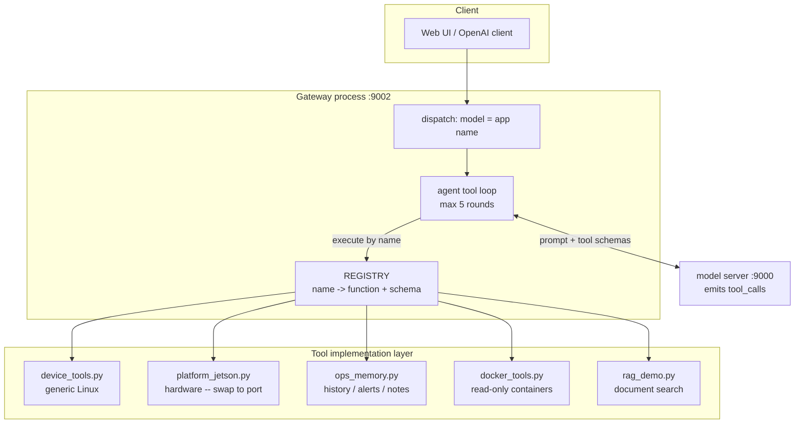
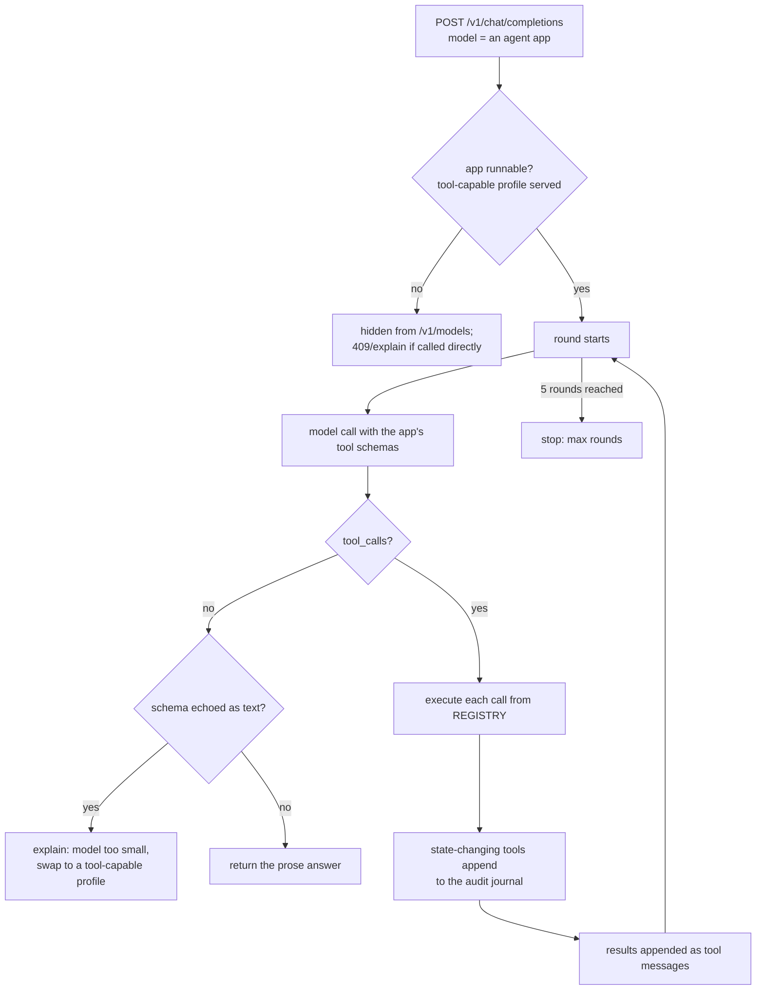
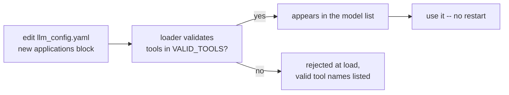
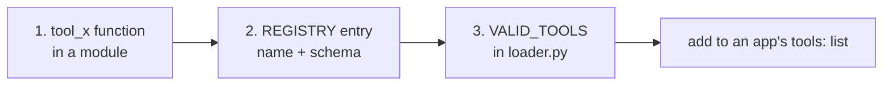
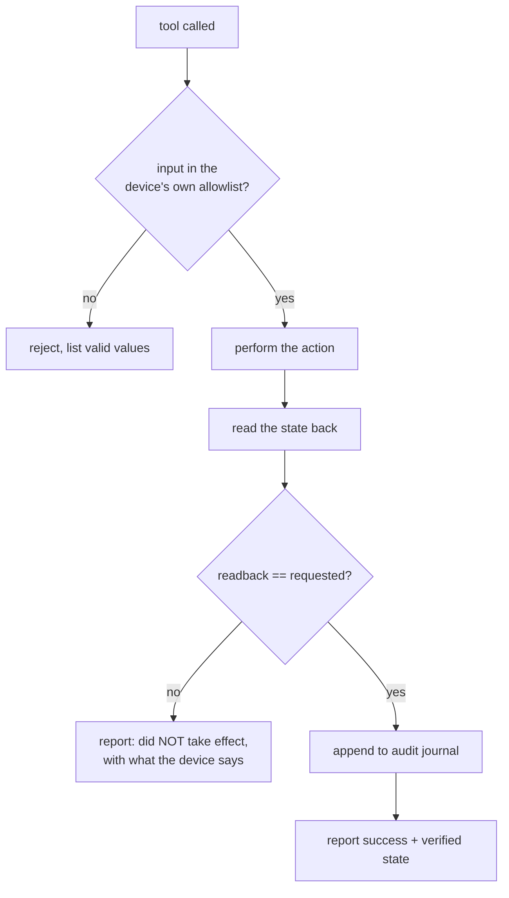
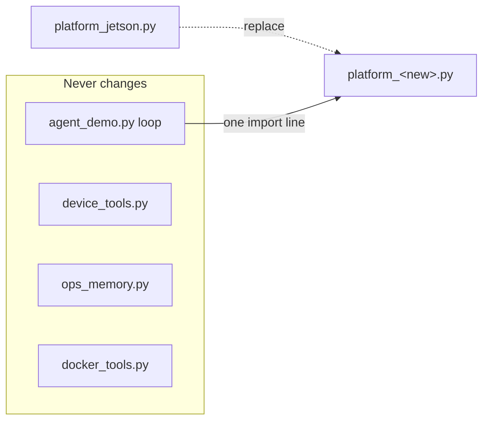

# WEDA LLM Suite — Agent Guide

Everything about the agent: what it is, how a request flows through it, and —
the heart of this document — how to extend it. Add an agent application with
no code, add a brand-new capability (tool) with a little, and port the whole
thing to new hardware by touching one file. Every extension point is shown
with the exact file, the exact change, and a working example.

## Contents

- [What "agent" means here](#what-agent-means-here)
- [Architecture](#architecture)
- [The request lifecycle](#the-request-lifecycle)
- [Ports, and connecting your application](#ports-and-connecting-your-application)
- [The tool registry](#the-tool-registry)
- [Extension 1 — add an agent application (no code)](#extension-1--add-an-agent-application-no-code)
- [Extension 2 — add a new tool (a little code)](#extension-2--add-a-new-tool-a-little-code)
- [Extension 3 — add a read-only telemetry source](#extension-3--add-a-read-only-telemetry-source)
- [Extension 4 — add an acting tool (with guardrails)](#extension-4--add-an-acting-tool-with-guardrails)
- [Extension 5 — port to new hardware](#extension-5--port-to-new-hardware)
- [Extension 6 — point an app at a remote model](#extension-6--point-an-app-at-a-remote-model)
- [The rules every extension must keep](#the-rules-every-extension-must-keep)
- [Testing an extension](#testing-an-extension)
- [Reference: the shipped tools](#reference-the-shipped-tools)

## What "agent" means here

An **agent application** is an app whose `kind: agent`. Unlike `chat` (plain
forward) or `rag` (retrieve then forward), an agent runs a **tool-calling
loop**: the model may emit OpenAI `tool_calls`, the gateway executes them
against a **closed registry** of Python functions, feeds the results back,
and repeats — up to five rounds — until the model answers in prose.

The defining principle, and the one every extension must preserve:

> **Config selects, code defines.** An application (YAML) can only *choose*
> tools from a fixed registry by name. A tool is *code*. No configuration
> file can introduce executable behavior — that boundary is the security
> story the product is sold on.

## Architecture



Four layers, each with a single job:

| Layer | File(s) | Responsibility |
|---|---|---|
| Application | `config/llm_config.yaml` | *declares* an agent: prompt + which tools, by name |
| Loop + registry | `scripts/agent_demo.py` | runs the tool-calling loop; `REGISTRY` maps names → (function, schema) |
| Generic capability | `scripts/device_tools.py`, `ops_memory.py`, `docker_tools.py`, `rag_demo.py` | portable implementations |
| Hardware capability | `scripts/platform_jetson.py` | the *only* silicon-specific file |

## The request lifecycle



Two safety behaviors are worth calling out because extensions inherit them
for free: a profile too small to emit real `tool_calls` is caught (it echoes
the schema as text) and answered with a clear message rather than garbage;
and every tool that changes device state is written to the audit journal.

## Ports, and connecting your application

The agent is reached the same way as any application on the suite — through
the **application gateway**, over the standard OpenAI API. You never call the
agent's tools directly; you select the agent as a *model* and it runs its
tool loop server-side.

| Port | Bind | What | Talk to it? |
|---|---|---|---|
| 3000 | `0.0.0.0` | Open WebUI | browser — the only port that leaves the device |
| **9002** | `127.0.0.1` | **application gateway** — every app (incl. agents) as a model | **yes — this is the one your app uses** |
| 9000 | `127.0.0.1` | generation server (raw model) | internal; benchmarks only |
| 9001 | `127.0.0.1` | embedding server (RAG) | internal |

The API ports bind loopback by default. To reach the gateway from another
machine, set `WEDA_LLM_HOST=0.0.0.0` in `.env`, recreate the stack, and put
it behind a firewall — the API carries no authentication.

**Connect an OpenAI client to the agent** — the agent is just a model name:

```python
from openai import OpenAI
client = OpenAI(base_url="http://<device>:9002/v1", api_key="none")

r = client.chat.completions.create(
    model="device-assistant",              # the agent, selected like a model
    messages=[{"role": "user", "content": "is the device healthy right now?"}])
print(r.choices[0].message.content)        # tool loop already ran server-side
```

Your code sees a normal chat completion; the tool calls, execution and
audit-journalling all happen inside the gateway. Swap the model string to
`device-assistant-rag`, `docs-qa`, `chat`, or any app you defined — same
call. Discover what is available (and runnable right now) with
`GET /v1/models`; the agent's own `get_network_info` tool will also report
the device's live IP, these ports with their roles, and this base URL.

For the full integration playbook — existing apps, new clients, the three
gotchas — see [APPLICATIONS.md](APPLICATIONS.md).

## The tool registry

`REGISTRY` in `agent_demo.py` is the single source of truth — a dict mapping
a tool name to `(implementation, json_schema)`:

```python
REGISTRY = {
    "get_time": (tool_get_time, {
        "type": "function", "function": {
            "name": "get_time",
            "description": "Current date and time on the edge device",
            "parameters": {"type": "object", "properties": {}}}}),
    # ... every other tool
}
```

A tool implementation is a plain function `tool_x(ctx, args) -> str`:
- `ctx` carries the app (`ctx["app"]`) and its tool list — used by tools that
  need app config (e.g. `search_documents` reads `ctx["app"].collection`).
- `args` is the parsed JSON the model supplied for the tool's parameters.
- The return is a **string** (usually `json.dumps(...)`) fed back to the model.

`config/loader.py` holds `VALID_TOOLS` — the allowlist a config is validated
against. A tool name not in `VALID_TOOLS` is rejected at load with the valid
set listed. This is the enforcement behind "config cannot invent code."

## Extension 1 — add an agent application (no code)

The most common extension. You are composing an assistant from tools that
already exist — pure YAML, no restart (the gateway reads config per request).

**Add a block to `config/llm_config.yaml` under `applications:`**

```yaml
  line-supervisor:
    kind: agent
    thinking: false
    system_prompt: >
      You are the Line 3 supervisor's assistant on an edge device. Use the
      device tools for live state and history; check documents for procedures.
      Report tool results exactly; never claim an action succeeded without a
      tool result.
    tools: [get_device_stats, get_telemetry_history, get_recent_alerts,
            search_documents, get_time]
    collection: line3_docs          # only because search_documents is present
    top_k: 4
    sampling: {temperature: 0.3}
    examples:
      - How has the temperature trended over the last 8 hours?
      - Any alerts overnight?
```

That is the whole change. The app appears in `/v1/models` and the Web UI
dropdown; run it with `./app.sh line-supervisor` or select it in the UI.



**Rules the loader enforces for you:** `kind: agent` requires a
tool-capable `llamacpp` profile (the python backend and tool-incapable
models are refused/hidden); every name in `tools:` must be in `VALID_TOOLS`;
`search_documents` in the list means the app needs a `collection` and the
embedding server.

## Extension 2 — add a new tool (a little code)

When no existing tool does what you need. Three edits, one pattern.

**Step 1 — write the implementation.** Put it in the module that fits its
nature (generic Linux → `device_tools.py`; hardware → `platform_jetson.py`;
new domain → a new module). The `tool_*` wrapper lives in `agent_demo.py`:

```python
# in agent_demo.py
def tool_get_kernel_version(ctx, args):
    import platform as _p
    return json.dumps({"kernel": _p.release(), "arch": _p.machine()})
```

**Step 2 — register it** in `agent_demo.py`'s `REGISTRY`:

```python
    "get_kernel_version": (tool_get_kernel_version, {
        "type": "function", "function": {
            "name": "get_kernel_version",
            "description": "The Linux kernel version and CPU architecture of "
                           "this device.",
            "parameters": {"type": "object", "properties": {}}}}),
```

**Step 3 — allowlist it** in `config/loader.py`:

```python
VALID_TOOLS = (..., "get_kernel_version")
```

Then add the name to any app's `tools:` list. Done.



**The description is not decoration — it is how the model finds the tool.**
A small model (4B) maps the user's words to a tool by its `description`. Use
the vocabulary users actually type. A log tool described only as
"container logs" can be ignored when users say "docker logs" -- write the
description to cover both.

**Parameters** follow JSON Schema. A tool that takes input:

```python
    "tail_log": (tool_tail_log, {
        "type": "function", "function": {
            "name": "tail_log",
            "description": "Return the last N lines of a named application log.",
            "parameters": {"type": "object", "properties": {
                "name": {"type": "string", "description": "which log"},
                "lines": {"type": "integer", "description": "how many, default 50"}},
                "required": ["name"]}}}),
```

## Extension 3 — add a read-only telemetry source

A read-only reading (a sensor, a counter, a status file) is the safest kind
of tool. Put the *reading* in `device_tools.py` (if generic) so it is
portable and testable on its own, and keep the `tool_*` wrapper thin:

```python
# device_tools.py
def fan_rpm():
    try:
        return int(open("/sys/class/hwmon/hwmon0/fan1_input").read().strip())
    except OSError:
        return None
```

```python
# agent_demo.py
def tool_get_fan_rpm(ctx, args):
    rpm = device_tools.fan_rpm()
    return json.dumps({"fan_rpm": rpm if rpm is not None else "unavailable"})
```

Register + allowlist as in Extension 2. Note the pattern the whole codebase
follows: **a reading that is missing returns `"unavailable"`, never an
exception** — degrade, don't crash.

To also have it *recorded over time* (so history/alert tools cover it), add
the field inside `ops_memory.py`'s `_sample()` and, if it should alert, a
threshold check in `_check_thresholds()`. Then it flows into
`get_telemetry_history` and `get_recent_alerts` automatically.

## Extension 4 — add an acting tool (with guardrails)

A tool that *changes* state must follow the pattern the shipped acting tools
use, or it breaks the product's trust story. Three non-negotiables:

1. **Validate the input against ground truth** before acting.
2. **Verify by readback** — never report success on the exit code alone.
3. **Record it** in the audit journal.

The template, from `set_power_mode`:

```python
def tool_set_fan_mode(ctx, args):
    mode = str(args.get("mode", "")).strip()
    valid = platform.fan_modes()               # 1. ground-truth allowlist
    if mode not in valid:
        return json.dumps({"error": f"'{mode}' not a valid fan mode",
                           "valid": valid})
    ok, detail = platform.set_fan_mode(mode)    # act, then read back
    ops_memory.record_action("set_fan_mode", f"mode={mode}",
                             detail if ok else f"FAILED: {detail}")  # 3. journal
    if not ok:                                   # 2. detail carries the readback
        return json.dumps({"error": detail})
    return json.dumps({"result": f"fan mode set to {mode}",
                       "verified_current": detail})
```

Also set the app's system prompt to instruct confirmation for ambiguous
requests, as the device-assistant prompt does: *"confirm with the user
before changing X if the request is ambiguous."*



## Extension 5 — port to new hardware

The entire hardware surface is one file. To run on non-Jetson silicon,
provide a `platform_<name>.py` with the same five functions:

```python
# platform_intel.py (example)
def gpu_percent(): ...          # or return None if no GPU
def gpu_freq_mhz(): ...
def power_modes(): ...          # [] if the platform has none
def current_power_mode(): ...   # (id, raw) or (None, reason)
def set_power_mode(mode_id): ... # (ok, detail) with readback
```

Then change one line in `agent_demo.py`:

```python
import platform_intel as platform    # was: platform_jetson
```

Everything else — `device_tools.py`, `ops_memory.py`, `docker_tools.py`, the
loop, every generic tool — is untouched and keeps working. Readings the new
platform lacks return `None`/`unavailable` and simply show blank.



## Extension 6 — point an app at a remote model

An app can run its pipeline locally but send generation to a different
server — a second device, a bigger box — via `endpoints:`. No code:

```yaml
  heavy-analyst:
    kind: agent
    system_prompt: ...
    tools: [get_device_stats, get_telemetry_history]
    endpoints:
      generation: http://192.168.1.50:9000/v1   # a bigger box on the LAN
```

The tools still execute on *this* device (they read *this* device's state);
only the model inference is remote. Useful when the local 4B is not strong
enough for the reasoning but the telemetry must come from the edge node.

## The rules every extension must keep

| Rule | Why | Enforced by |
|---|---|---|
| Config selects, code defines | the security story: a YAML edit can never run new code | `VALID_TOOLS` allowlist in `loader.py` |
| Tools return strings, never raise to the loop | one bad tool must not crash the turn | wrap risky work in try/except, return an `{"error": ...}` string |
| Missing capability → `"unavailable"`, not a traceback | the same code runs on hardware that lacks the feature | every reading degrades |
| Acting tools: validate, verify by readback, journal | trust — the agent must never claim an unverified success | the Extension 4 pattern |
| Hardware specifics live only in `platform_*.py` | one-file porting | code review |
| Descriptions use the user's vocabulary | a small model finds tools by description | testing with real phrasings |

## Testing an extension

Every tool is a plain function — test it without the model, the way the
suite's own checks do:

```bash
# inside the container (or any env with the deps)
python3 - <<'PY'
import sys; sys.path.insert(0, "/wise-edge/app/scripts"); sys.path.insert(0, "/wise-edge/app")
import agent_demo, json
print(agent_demo.tool_get_kernel_version(None, {}))
PY
```

Then confirm the loader accepts the app that uses it:

```bash
python3 -c "import sys,os; sys.path.insert(0,'.'); os.environ.setdefault('HF_HOME','/tmp/hf'); \
from config.loader import load_app; print(load_app('line-supervisor').tools)"
```

Then run `./wise-bench` — the capability verification must stay green after
your change (the configuration check parses every application, so a typo in
a tool list fails there with the valid names listed).

Finally, on the device, exercise it through the agent (`./app.sh
device-assistant "..."`) and — for anything that acts — confirm the effect
independently (the way a power-mode change is checked against
`nvpmodel -q`). A tool is not done until it has been driven by the model and
its effect verified outside the agent.

## Reference: the shipped tools

The registry as it ships. Read tools return state; act tools change it and
are journaled. `device-assistant` carries the read + act + ops + docker set;
`device-assistant-rag` adds `search_documents`.

| Tool | Class | Module | Summary |
|---|---|---|---|
| `get_time` | read | agent_demo | date/time on the device |
| `calculator` | read | agent_demo | AST-whitelisted arithmetic (no eval) |
| `get_device_stats` | read | device_tools + platform | CPU/GPU/mem/swap/disk/thermal/top-processes in one call |
| `get_network_info` | read | device_tools | device IPs, listening ports with roles, API endpoints for new clients |
| `search_documents` | read | rag_demo | hybrid retrieval over an app's corpus |
| `get_telemetry_history` | read | ops_memory | min/avg/max/peak over the recorded window |
| `get_recent_alerts` | read | ops_memory | threshold breaches raised/cleared + active now |
| `get_action_history` | read | ops_memory | the audit journal of state-changing actions |
| `check_anomalies` | read | ops_memory | z-score of recent telemetry vs the 7-day baseline |
| `remember_note` / `recall_notes` | read/write | ops_memory | operator handover log, semantic when the embed server is up |
| `explain_recent_errors` | read | ops_memory | error/warning lines from the stack's own container logs |
| `list_containers` / `inspect_container` / `container_stats` | read | docker_tools | docker ps / inspect / stats, read-only |
| `get_power_modes` | read | platform_jetson | the device's power-mode table + current |
| `set_power_mode` | **act** | platform_jetson | switch mode, verified by readback, journaled |
| `free_memory` | **act** | device_tools | flush reclaimable page cache, before/after numbers, journaled |
| `generate_report` | **act** | ops_memory | write a markdown health report |

To see the live set on a running device, ask the agent for its network info
or read `config/loader.py`'s `VALID_TOOLS` — the allowlist is authoritative.
