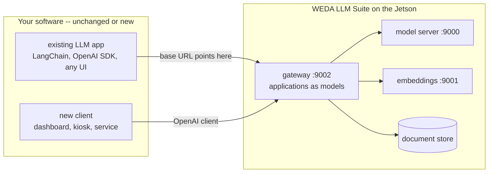
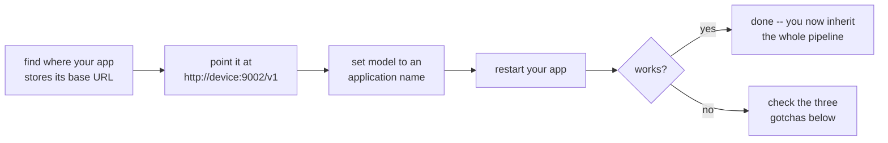
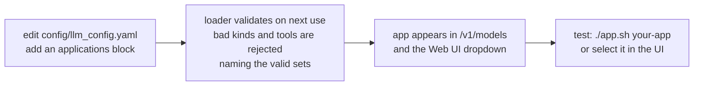
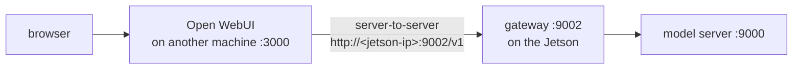
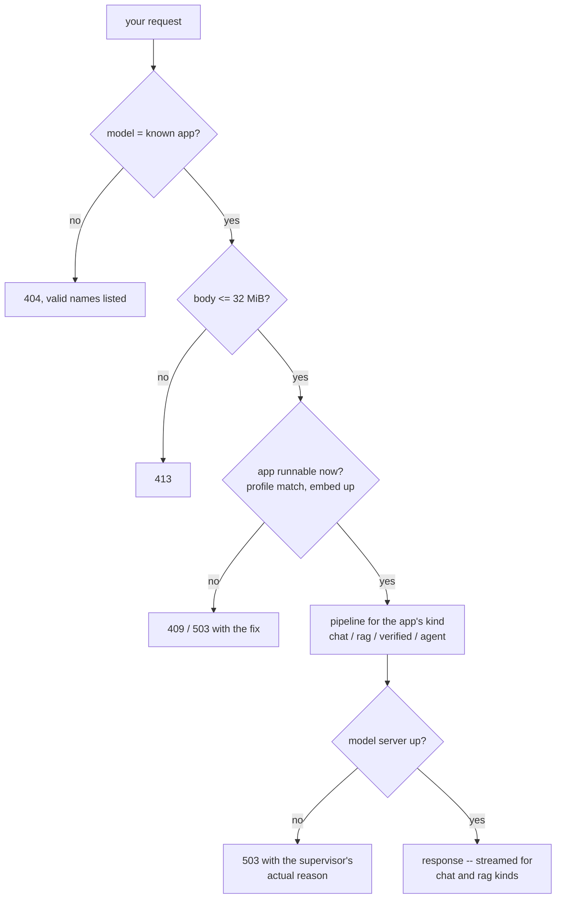

# WEDA LLM Suite — Building and Integrating Applications

How to put *your* application on this pipeline. Three paths, ordered by
effort: point an existing LLM application at the suite (usually zero code),
define a new assistant inside the suite (YAML only), or build a new client
from scratch (two endpoints). Every sample below runs against a stock
deployment.

## Contents

- [Where your application sits](#where-your-application-sits)
- [Path A — integrate an existing LLM application](#path-a--integrate-an-existing-llm-application)
- [Path B — define a new application inside the suite](#path-b--define-a-new-application-inside-the-suite)
- [Path C — build a new client from scratch](#path-c--build-a-new-client-from-scratch)
- [Hosting the Web UI on another device](#hosting-the-web-ui-on-another-device)
- [The request lifecycle your app rides on](#the-request-lifecycle-your-app-rides-on)
- [Limitations on this hardware](#limitations-on-this-hardware)

## Where your application sits

Everything integrates at one place: the **application gateway on port
9002**, speaking the standard OpenAI chat-completions API. Your code never
talks to the model server directly and never needs an SDK of ours.



The gateway's own applications (`chat`, `docs-qa`, `docs-qa-verified`,
`device-assistant`, …) appear as *models*: your code selects a whole
pipeline the same way it used to select a checkpoint — by the `model`
string. Swapping `"chat"` for `"docs-qa"` upgrades a plain chatbot into
cited document answering with **zero** further changes on your side.

## Path A — integrate an existing LLM application

Almost every LLM application built in the last two years talks to its
model through the OpenAI chat-completions shape, pointed at one configured
base URL. That URL is the only thing that changes.



### Step 1 — find the one setting

| Your app was built with | Where the address lives | Change to |
|---|---|---|
| LangChain / LlamaIndex | `ChatOpenAI(base_url=...)` or an `OPENAI_API_BASE`-style env var | `http://127.0.0.1:9002/v1` (on-device) or `http://<device-ip>:9002/v1` |
| OpenAI SDK (Python/JS) | `OpenAI(base_url=...)` or `OPENAI_BASE_URL` | same |
| Raw HTTP / curl / custom | a URL constant or config entry | same |
| Another chat UI (Open WebUI etc.) | its `.env` — the OpenAI backend URL variable | same |

If the address is already an env var or config value — the default in
every framework above — the integration is **zero lines of code**: edit
the value, restart the process.

### Step 2 — before and after, in real code

LangChain (any chain, agent or RAG built on `ChatOpenAI` keeps working):

```python
# before: cloud or Ollama-proxy
llm = ChatOpenAI(model="gpt-4o-mini", api_key="sk-...")

# after: the suite -- same object, same chains downstream
llm = ChatOpenAI(model="chat",
                 base_url="http://127.0.0.1:9002/v1",
                 api_key="none")          # any placeholder is accepted
```

OpenAI SDK:

```python
from openai import OpenAI
client = OpenAI(base_url="http://127.0.0.1:9002/v1", api_key="none")

reply = client.chat.completions.create(
    model="docs-qa",                       # a pipeline, chosen by name
    messages=[{"role": "user", "content": "What is the warranty period?"}],
    stream=True,
)
for chunk in reply:
    print(chunk.choices[0].delta.content or "", end="")
```

Plain HTTP:

```bash
curl -s http://127.0.0.1:9002/v1/chat/completions \
  -H "Content-Type: application/json" \
  -d '{"model": "chat", "messages": [{"role": "user", "content": "hello"}]}'
```

### Step 3 — what you inherit without asking

| Inherited behavior | Meaning for your app |
|---|---|
| Conversation overflow handling | oldest turns are dropped and retried server-side — your app never sees a context-length crash mid-conversation |
| Failure honesty | a model swap or refusal reaches you as a structured 503 **with the reason** ("does not fit: 7.2 GiB needed vs 4.9 available"), not a dead socket |
| Image handling | attached images are OCR'd into text before the model sees them |
| Future upgrades | a faster model or smarter retrieval lands on the device; your app gets it the day of the swap, unchanged |

### The three gotchas

1. **The `/v1` suffix.** Some frameworks append `/v1` themselves, some
   expect it in the base URL. If you get 404s on every call, toggle it.
2. **Off-device clients.** The API binds `127.0.0.1` by default. An app on
   another machine needs `WEDA_LLM_HOST=0.0.0.0` in `.env` (restart the
   stack) — and a firewall, because the API carries no authentication.
3. **Ollama-native callers.** Code that uses Ollama's *private* API
   (`/api/chat`, `/api/generate`, `ollama pull`) is not OpenAI-shaped and
   cannot be re-pointed by URL. Any OpenAI-compatible mode your tool
   offers is the path; the model-management endpoints have no equivalent
   here by design — models are provisioned with `download_models.py`.

## Path B — define a new application inside the suite

An in-suite application is a **YAML block**, not code: it gets a name in
the model list, a system prompt, and — depending on `kind` — retrieval or
tools. The gateway reads the config per request, so a new block appears
in the Web UI dropdown on the next model-list refresh, **no restart**.



A complete example — a maintenance assistant over your own manuals:

```yaml
applications:
  maintenance-helper:
    kind: rag
    thinking: false
    system_prompt: >
      You are the maintenance assistant for Line 3. Answer strictly from
      the provided context. Cite snippets as [n]. If the context does not
      cover it, say so and name the document that should.
    collection: line3_manuals          # its own store, isolated from other apps
    docs_dir: line3                    # subfolder of DOCS_DIR
    top_k: 4
    rerank: true
    sampling: {temperature: 0.2}
    examples:
      - What is the torque spec for the conveyor coupling?
```

Then: put the manuals in `DOCS_DIR/line3/`, run
`./app.sh maintenance-helper ingest`, and ask — terminal, Web UI, or API.

What each `kind` gives you:

| kind | You write | The pipeline provides |
|---|---|---|
| `chat` | prompt + sampling | streaming, overflow handling |
| `rag` | prompt + corpus keys | ingest (incremental), hybrid retrieval, citations, optional rerank |
| `rag-verified` | same + `verify_rounds` | grading, query rewrite, claim-by-claim verification |
| `agent` | prompt + a `tools:` list from the fixed registry | the tool-calling loop, execution, guardrails |

Two boundaries, both deliberate:

- **Config cannot create code.** `kind` and tool names come from fixed
  sets; a new *tool* is a function + schema pair added to `REGISTRY` in
  `scripts/agent_demo.py` plus its name in `VALID_TOOLS` — a code change,
  reviewed like one.
- **`endpoints:` can point an app elsewhere.** Any app may target another
  OpenAI-compatible server (a second device, a bigger box) instead of the
  local model — the rest of its pipeline stays.

## Path C — build a new client from scratch

The entire API surface a new application needs:

```
GET  http://<device>:9002/v1/models            # list the applications
POST http://<device>:9002/v1/chat/completions  # ask one, streaming supported
```

Minimal, robust client — discovery, selection, and the two errors worth
handling:

```python
import time
from openai import OpenAI

client = OpenAI(base_url="http://127.0.0.1:9002/v1", api_key="none")

apps = [m.id for m in client.models.list().data]   # only apps that can run NOW
model = "docs-qa" if "docs-qa" in apps else apps[0]

for attempt in range(3):
    try:
        r = client.chat.completions.create(
            model=model,
            messages=[{"role": "user", "content": "Summarise today's checks."}])
        print(r.choices[0].message.content)
        break
    except Exception as e:
        msg = str(e)
        if "503" in msg:          # model loading/swapping -- message says which
            time.sleep(10); continue
        if "409" in msg:          # app pinned to a profile not being served
            raise SystemExit(msg) # the message names both sides and the fix
        raise
```

Notes that save an afternoon: the model list is **honest** — apps that
cannot run right now are absent, so build your picker from `GET /models`
rather than hardcoding; keep request bodies under 32 MiB (attached images
count, base64-inflated); any `api_key` value is accepted.

## Hosting the Web UI on another device

The bundled Open WebUI can run on a different machine — a workstation, a
panel PC, a small server — with the Jetson serving only the API. The
browser↔UI hop moves off-device; the hop that matters becomes the remote
UI's backend calling the Jetson's gateway, server-to-server.



**On the Jetson** — the API binds loopback by default, so first open the
gateway to the network. In `.env`:

```bash
WEDA_LLM_HOST=0.0.0.0
```

then `./build.sh --stop && ./build.sh`. **This is the security decision of
the setup**: the API carries no authentication, so firewall port 9002 to the
UI host specifically, not the whole subnet:

```bash
sudo ufw allow from <ui-host-ip> to any port 9002
```

**On the UI machine** — point its Open WebUI at the Jetson's gateway:

```bash
OPENAI_API_BASE_URL=http://<jetson-ip>:9002/v1
OPENAI_API_KEY=empty
ENABLE_OLLAMA_API=false
TASK_MODEL_EXTERNAL=chat
```

`TASK_MODEL_EXTERNAL=chat` matters more remotely than locally: without it,
every background title/tag task runs a full agent tool loop across the
network and queues behind real requests on the single slot.

**Optionally, stop the Jetson's local UI** once the remote one works:
`docker stop open-webui`. That frees a few hundred MB of the 8 GB (directly
widening model-fit headroom) and removes the device's only externally
listening port — the Jetson then exposes exactly one thing: the firewalled
gateway.

Two non-changes worth knowing: the gateway needs no CORS configuration for
this (the remote backend calls it server-to-server, where CORS does not
apply), and nothing in the suite's config or code changes — the split is
`.env`/environment only.

## The request lifecycle your app rides on



Every error is OpenAI-shaped JSON with a human remedy in the message —
surface it to your user verbatim and they can usually fix it themselves.

## Limitations on this hardware

Honest numbers for an 8 GB unified-memory Orin — design your application
around them rather than discovering them in production:

| Limitation | Number / behavior | Design consequence for your app |
|---|---|---|
| One resident model | swapping takes ~15–30 s of downtime; requests during it get the 503-with-reason | don't build flows that hop between profiles per request; pick one and stay |
| Throughput ceiling | ~20 tok/s generation, ~700 tok/s prompt processing (4B Q4 class) | a 300-token answer takes ~15 s; stream it — a spinner for 15 s feels broken, streaming feels alive |
| Single slot by default | requests queue per slot; a second conversation waits for the first (504 after 300 s) | for concurrent users use a `parallel: 2` profile (halves the per-conversation window) |
| Context window vs memory | 8 k default; 16 k costs ~0.6 GiB more KV; the window is also your conversation memory — oldest turns drop when it fills | keep system prompts lean; don't re-send giant histories; put documents in the corpus, not the chat |
| Model size ceiling | ~4.6 GB weights (Gemma-class) is the practical top; the fit gate refuses what does not fit, with numbers | there is no "just use the 70B" on this device — the design answer is better retrieval, not a bigger model |
| Verified answers are slow | `docs-qa-verified` = 3–5 model calls, 15–40 s | use it for answers that get acted on; use `docs-qa` for conversation |
| Text-only models | images are OCR'd to text (~2–5 s per page, CPU); no visual understanding, no image generation | printed text in images works; "what's in this photo" does not |
| RAG needs opt-in memory | the embedding server costs ~90 MB and starts only with `./build.sh --embed` | RAG apps 503 (with the command) until the operator opts in |
| History depth is bounded | the telemetry recorder keeps a ~7-day ring at the 30 s default interval; older samples roll off | for longer retention widen `interval_sec` in the `monitoring:` block, or export `test_logs/ops/` periodically |
| No API authentication | loopback by default; opening `WEDA_LLM_HOST` exposes an unauthenticated API | keep it behind a firewall; put your own auth in *your* app if it fronts users |
| Request body cap | 32 MiB per request | downscale attached images; big documents go through `ingest` |
| Tool calls need the C++ backend | the `python` parity backend cannot emit them (enforced at config load) | agent apps only on default profiles — the loader stops you before runtime does |
