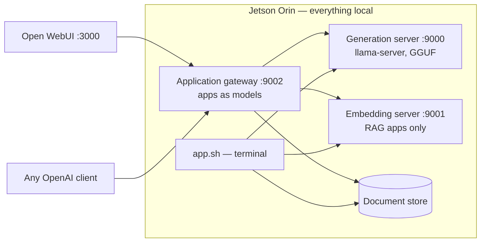
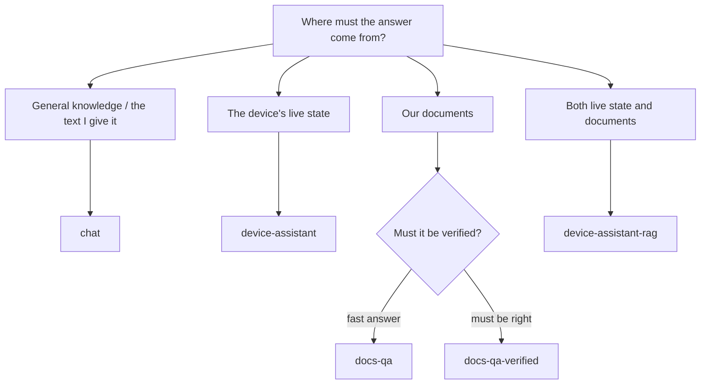

# WEDA LLM Suite — Jetson Orin (JetPack 6, 8 GB)

A complete, private LLM platform that runs entirely on one Jetson Orin: chat,
tool-calling agents, and retrieval-augmented answering (RAG) over your own
documents — served through standard OpenAI-compatible endpoints, with a web
UI, in 8 GB of unified memory. No cloud, no API keys, no per-token cost, no
data leaving the device.

## Contents

- [Why on-device, and why this bundle](#why-on-device-and-why-this-bundle)
- [What you get](#what-you-get)
- [Which application for which job](#which-application-for-which-job)
- [When to use which approach](#when-to-use-which-approach)
- [System requirements](#system-requirements)
- [Model cache: where models live](#model-cache-where-models-live)
- [Permissions](#permissions)
- [Setup](#setup)
- [Quick start, step by step](#quick-start-step-by-step)
- [Applications](#applications)
- [Model profiles](#model-profiles)
- [Choosing a backend: llama-server vs Python](#choosing-a-backend-llama-server-vs-python)
- [RAG: answer questions from your documents](#rag-answer-questions-from-your-documents)
- [Agents: models that act](#agents-models-that-act)
- [Web UI](#web-ui)
- [Benchmarking](#benchmarking)
- [Offline operation](#offline-operation)
- [Memory guidance](#memory-guidance)
- [Creating your own application](#creating-your-own-application)
- [Adding a model](#adding-a-model)
- [Command reference](#command-reference)
- [Bundle layout](#bundle-layout)

## Why on-device, and why this bundle

Running the model where the data is changes the economics and the risk
profile of an LLM deployment:

| Concern | Cloud LLM service | This bundle |
|---|---|---|
| Data privacy | prompts and documents leave the site | nothing leaves the device — prompts, documents and vectors stay local |
| Cost model | per-token, forever | hardware you already own; zero marginal cost per request |
| Availability | needs a working uplink | serves with the network cable unplugged (after one model download) |
| Latency floor | network round trip on every token | first token ~1 s, steady ~20 tok/s measured on Orin 8 GB |
| Integration | vendor SDK | standard OpenAI API — existing clients work unchanged |

What makes this bundle more than "llama.cpp in a container":

- **Applications as models.** The gateway (:9002) publishes each *application*
  — chat, document-QA, device agent — as a selectable model. Any OpenAI
  client, including the bundled web UI, picks `docs-qa` from a dropdown and
  gets retrieval with citations; picks `device-assistant` and gets an agent
  that reads live device telemetry. The client needs zero custom code.
- **One config file drives everything.** Models, serving shape, applications,
  prompts, tools, retrieval settings — all in `config/llm_config.yaml`.
  Creating an assistant is copying a YAML block.
- **Hot swap.** Edit the config while serving and the model is replaced
  in-place: the supervisor stops the old model, waits until its memory has
  actually returned, flushes page caches, runs the fit check (weights + KV +
  runtime vs live free memory) and only then loads. When the incoming model
  is short on headroom, the supervisor first reclaims idle memory from the
  stack's other containers into swap (the Web UI pages back in on its next
  use) — the same headroom a full restart would free, without dropping
  anyone's session. A model that still does not fit is refused with the
  numbers and the remedy, never attempted. `READY` banner on success, no
  container restart.
- **Fits-first engineering for 8 GB.** `./app.sh check` computes model +
  KV-cache footprint against live free memory *before* you download anything;
  page caches are flushed before every load; profiles for larger models ship
  pre-shaped (single slot, compressed KV cache). These are the differences
  between "works in a demo" and "works Monday morning."
- **Honest failure messages.** A model swap in progress, a missing embedding
  server, an oversized input — each answers with what happened and the exact
  command that fixes it, in the UI and on the API.

Measured on Jetson Orin 8 GB with the default profile: ~20 tok/s sustained
decode (also under two concurrent conversations), ~700 tok/s prompt
processing, ~7 s warm model load.

## What you get



| Layer | Component |
|---|---|
| Serving | C++ `llama-server` (OpenAI-compatible, parallel slots, tool calls) and a Python fallback backend |
| Gateway | port 9002 — exposes every application as a selectable model |
| Frontend | Open WebUI on port 3000, connected through the gateway |
| Applications | declared in one config file, run with `./app.sh` |
| Models | GGUF Q4_K_M profiles; download on first use, cached, then offline-capable |

Two scripts with a strict split:

| Script | Job |
|---|---|
| `./build.sh` | lifecycle — start/stop containers and servers, status |
| `./app.sh` | applications — run anything defined in the config |

## Which application for which job

| You want to… | Use | Why this one |
|---|---|---|
| Ask general questions, draft text, summarise | `chat` | plain assistant, lowest latency, no extra servers |
| Know the device's live state, its **history** (overnight trends, alerts, anomalies), or act on it: switch the power mode, free RAM | `device-assistant` | reads live telemetry AND recorded history/alerts, keeps an audit journal of every action, takes operator notes across shifts, and can explain its own recent errors — actions verified against the device's own readback |
| Get answers **from your own documents** (text, PDF incl. scans, Office, HTML, images), with sources | `docs-qa` | retrieval with citations; refuses to invent when the answer is not in the corpus |
| An operator assistant that uses live data *and* site documentation | `device-assistant-rag` | the agent decides per question whether to read telemetry or search the document store |
| A document answer that must be **right**, not fast — compliance, safety, specifications | `docs-qa-verified` | retrieval is graded, the query rewritten and retried when nothing relevant came back, and the final answer verified claim-by-claim against the sources; unsupported statements are flagged |
| Validate a client against the classic Python serving stack | `python-parity` | same API served by `llama_cpp.server` — compatibility reference, no tool calls |

Typical deployments built from these shapes: shift-handover assistant on a
factory line (chat), maintenance-manual QA at an unconnected site (docs-qa),
first-line device triage without SSH access (device-assistant), operator
copilot over SOPs plus live state (device-assistant-rag).

**The applications are roles, not different models.** All of them run the one
model being served; what differs is what each is *allowed to reach*. An app
never has a capability its row does not list — asking `chat` "how hot is the
device?" gets a general-knowledge guess, not a reading, because `chat` has no
telemetry tool. Pick the app by the source of truth the answer must come from:

| Capability | `chat` | `device-assistant` | `docs-qa` | `docs-qa-verified` | `device-assistant-rag` | `python-parity` |
|---|---|---|---|---|---|---|
| General knowledge, drafting, summarising | ✅ | ✅ | ➖ context only | ➖ context only | ✅ | ✅ |
| Live device telemetry (temperature, memory/swap, CPU/GPU load, disk, top processes), time, arithmetic | ❌ | ✅ tools | ❌ | ❌ | ✅ tools | ❌ |
| Acts on the device: power mode switch (verified), free reclaimable RAM | ❌ | ✅ tools | ❌ | ❌ | ✅ tools | ❌ |
| Answers grounded in your documents, with citations | ❌ | ❌ | ✅ always | ✅ always | ✅ when it decides to search | ❌ |
| Refuses to invent when the answer is not in the documents | — | — | ✅ | ✅ + verified claim-by-claim | ➖ only for document questions | — |
| Answer latency on Orin | ~1 s to first token | + tool rounds | ~2 s to first token | **15–40 s** (3–5 model calls) | + tool rounds | ~1 s |
| Text read from attached images (OCR) | ✅ | ✅ | ✅ | ✅ | ✅ | ✅ |
| Needs the embedding server (`--embed`) | no | no | yes | yes (+ reranker model) | yes | no |
| Serving backend | C++ | C++ (tool calls) | C++ | C++ | C++ (tool calls) | Python (reference) |
| Follows the served model after a swap | yes | yes | yes | yes | yes | pinned to its own profile |

➖ `docs-qa` is deliberately narrow: its prompt restricts it to the retrieved
context, so it is the wrong app for open questions. `device-assistant-rag` is
the broadest — the agent chooses per question between live tools and
document search — and therefore also the slowest (tool rounds). `chat` is the
fastest and knows nothing about the device or the documents. New roles are
new YAML blocks: a different prompt, tool set and corpus, same model.

## When to use which approach

Two decisions, in this order: **where must the answer come from** (that picks
the application), then **who is asking** (that picks the access path).



| Situation | App | Example prompt | What you get |
|---|---|---|---|
| Draft a handover note, rewrite a message, explain a concept | `chat` | "Summarise this shift log into five bullets: …" | the model's own answer, fastest |
| Check the machine without SSH | `device-assistant` | "Is there enough free memory to start another workload?" | a reading from `get_device_stats`, then a judgement on it |
| Procedure or spec questions from the site manuals | `docs-qa` | "What torque does the pump cover need?" | the answer **with `[n]` citations**, or "not in the documents" |
| A specification or compliance answer someone will act on | `docs-qa-verified` | "Which torque does the pump cover require, and where is it stated?" | the answer with citations, **after** the pipeline graded the sources and verified each claim — or an explicit "the documents do not contain this" |
| Operator copilot: "what does the SOP say, and are we compliant right now?" | `device-assistant-rag` | "Check the docs for the memory guidance, then tell me if we currently comply." | document lookup **and** a live reading, combined |
| Read a label, screenshot or scanned page | any app, attach the image | "What does this error screen say?" | the image's text, via OCR, answered by that app's role |
| A client written against `llama_cpp.server` must be validated | `python-parity` | the client's own traffic | the Python backend's behaviour, nothing more |

**Wrong-app examples — they answer, but from the wrong source:**

| Prompt | App used | Result | Should have been |
|---|---|---|---|
| "How hot is the device?" | `chat` | a plausible number from general knowledge | `device-assistant` |
| "What's the pump torque spec?" | `chat` | a typical value, not *your* manual's | `docs-qa` |
| "Explain unified memory in two sentences" | `docs-qa` | "not in the documents" (correct behaviour for its role) | `chat` |

**Access paths — who is asking:**

| Path | Use it when | How |
|---|---|---|
| Web UI (`:3000`) | people interact — conversation history, file attachments, model/app picker | open `http://<device-ip>:3000`, pick the app in the dropdown |
| `./app.sh` (terminal) | operators at a shell, scripted one-shots, ingest and checks | `./app.sh device-assistant "is the device under load?"`; `./app.sh docs-qa ingest` |
| OpenAI API (`:9002`) | another program integrates — dashboards, automations, other services | `POST /v1/chat/completions` with `"model": "<app>"`; any OpenAI client library works unchanged |

All three reach the same applications with the same behaviour; the gateway
index (`http://127.0.0.1:9002/`) prints a ready-made `curl` for each app.
Lifecycle tasks (start, stop, ingest, model checks) exist only on the
terminal path by design — the UI and the API never start servers or change
models.

## System requirements

| Item | Requirement |
|---|---|
| Device | Jetson Orin (NX / Nano class), 8 GB unified memory |
| OS / BSP | JetPack 6.x (L4T r36, Ubuntu 22.04) |
| Image | `weda-llm-base` **1.0.0-orin or later** (earlier images lack the C++ server; agent and RAG modes refuse with a clear message) |
| Docker | docker + docker compose v2, `nvidia` runtime configured (`./build.sh` verifies and warns if not) |
| Disk | ~1–5 GB per model in the cache; ~4 GB for the Open WebUI image |
| Host Python | python3 with `huggingface-hub` and `pyyaml` — only for the optional host-side `download_models.py` |
| Network | first model download only; fully offline afterwards |
| Power (optional) | `sudo jetson_clocks` + 25 W mode for maximum throughput |

## Model cache: where models live

`HF_CACHE` in `.env` is the host directory where GGUF files are stored, and
it is mounted into the containers at `/models/huggingface`:

| Setting | Effect | Choose it when |
|---|---|---|
| `HF_CACHE=./model_cache/huggingface` *(default)* | everything stays inside this bundle directory | clean installs, demo machines, easy full removal |
| `HF_CACHE=/home/<you>/.cache/huggingface` | shares the standard Hugging Face cache | the host already has models cached, or other tools should reuse these downloads |

Both the containers and the host-side `download_models.py` read and write the
same cache, so a model downloaded either way is never fetched twice. Deleting
the cache directory removes all models; they re-download on next use.

## Permissions

The serving containers run as root and download models into the shared cache,
so files created *by the containers* are root-owned on the host. Two visible
consequences, both harmless to operation:

- Host-side tools may print a permission warning for auxiliary files — e.g.
  Hugging Face's transfer backend logging
  `Permission denied ... falling back to console logging`. Downloads still
  succeed.
- `rm -rf` of the cache from the host may need `sudo`.

To make the cache fully owned by your user again:

```bash
sudo chown -R "$USER:$USER" <your HF_CACHE directory>
```

Run it any time; it can be needed again after a container downloads a new
model. The scripts themselves need no elevated permissions — `build.sh` and
`app.sh` run as your user and talk to Docker.

## Setup

1. **Make the scripts executable.** Copying or extracting the bundle can drop
   the execute bits; without them every `./build.sh` or `./app.sh` call fails
   with `Permission denied`. From the directory that *contains* the bundle:

```bash
chmod +x weda-llm-suite
cd weda-llm-suite
chmod +x build.sh app.sh entrypoint.sh wise-bench scripts/*
```

2. (Optional) adjust `.env` — the shipped defaults run as-is:

```bash
WEDA_LLM_IMAGE=harbor.edgesync.cloud/weda-release/weda-llm-base:1.0.0-orin
HF_CACHE=./model_cache/huggingface   # see "Model cache" above
DOCS_DIR=./docs_sample               # your document folder for RAG
```

3. **Download the models** — this is the only step that fetches anything.
   `build.sh` starts servers; it never downloads, and it refuses to start a
   profile whose model is not in the cache (so a start is never a silent
   multi-GB wait):

```bash
python3 scripts/download_models.py            # interactive: pick the profiles you want
python3 scripts/download_models.py --status   # what is cached, what is missing
python3 scripts/download_models.py --all      # everything
```

   The default profile plus the embedding model is enough to begin; add
   others any time before swapping to them.

Before downloading a large model, `./app.sh check <profile>` reports its file
size, KV-cache need at the profile's settings, and whether it fits the memory
currently free on the device. The check runs inside the container, so start the
stack once (`./build.sh`, quick start below) before using it; with the stack
down it answers `container 'weda-llm-suite' is not running`.

## Quick start, step by step

```bash
./build.sh
```

Checks that the profile's model is in the cache (if not, it names the
missing file and exits with the download command — nothing is started), then
starts three containers (generation server, application gateway, Open WebUI),
waits until the model answers on :9000 and the gateway on :9002, and prints
the endpoints. A warm start is seconds. The serving log prints an
unmissable banner when the model is ready:

```
======================================================================
[serve] READY -- serving 'qwen3-4b-q4km' (profile qwen3-4b-q4km) on :9000
======================================================================
```

```bash
./build.sh --status
```

The one command to answer "what is running?": per-container state and
health, the model currently served, embedding server up/down, and the
gateway's application list.

```bash
./app.sh                          # list applications with example prompts
./app.sh chat                     # interactive terminal chat
./app.sh device-assistant "how hot is the device right now?"
```

`app.sh` never starts servers — it runs applications against the servers
`build.sh` started, and tells you exactly what to start if one is missing.

Then open `http://<device-ip>:3000` for the Web UI (first visit creates the
admin account).

RAG applications need the embedding server and an indexed corpus:

```bash
./build.sh --embed                # starts the second (embedding) server too
./app.sh docs-qa ingest           # chunk + embed + store the documents in DOCS_DIR
./app.sh docs-qa ask "what is in these documents?"
```

Stop everything with `./build.sh --stop`.

**Reboots and restarts.** The containers restart on their own after a device
reboot or a crash (`restart: unless-stopped`); only an explicit
`./build.sh --stop` keeps them down. Never use `docker compose down -v`: the
`-v` deletes the document store and the Web UI accounts — `./build.sh --stop`
preserves both.

## Applications

| App | What it does | Try |
|---|---|---|
| `chat` | plain assistant over the API | `./app.sh chat` |
| `device-assistant` | agent with live tools: device memory/load/temperature, time, calculator | `./app.sh device-assistant "is the device under load?"` |
| `docs-qa` | answers questions from your documents, with cited sources | `./app.sh docs-qa` |
| `device-assistant-rag` | agent that can also search your documents when it decides that helps | `./app.sh device-assistant-rag` |
| `docs-qa-verified` | document answers that are graded, retried and verified before you see them (3–5 model calls) | `./app.sh docs-qa-verified ask "…"` |
| `python-parity` | same chat API served by the classic Python backend | `./app.sh python-parity` |

`./app.sh` shows example prompts for each application; the gateway's index
page (`http://127.0.0.1:9002/`) lists the same with ready-made `curl` commands.

**Which model an application runs on.** Apps without a `profile:` key follow
whatever model is being served (`default_profile`, or the `-p` you started
with) — `chat`, `docs-qa` and both assistants work this way, so a model swap
carries them along. An app *with* a `profile:` key is pinned: it runs only
when that exact profile is served and refuses otherwise (409, with the two
ways to reconcile). `python-parity` is pinned to `qwen3-4b-q4km-python` by
design — it exists to exercise the Python backend — so it works only after:

```bash
./build.sh --stop && ./build.sh -p qwen3-4b-q4km-python
```

The Web UI dropdown only offers what can answer right now: a pinned app
whose profile is not being served is **not listed** (it reappears when its
profile is served). The gateway's index page, `http://127.0.0.1:9002/`, shows
every app with `available: true/false` and the profile currently serving.

**Long conversations.** Clients resend the whole history on every message, so
any conversation eventually outgrows the model's window. The gateway handles
this: when the server rejects a request for size, the oldest exchanges are
dropped and the request retried — the chat continues, the model simply no
longer remembers its earliest turns. Agent apps reach this sooner (their tool
definitions occupy part of every prompt).

Each application also carries its own `sampling:` preset — factual apps like
`docs-qa` run cool (temperature 0.2), conversational apps warmer (0.7). Web UI
and API clients can still override per request.

The interactive applications ship with the model's *reasoning phase disabled*
(`thinking: false` in their config blocks): on this hardware a reasoning
preamble costs 10–20 s before the first visible word, and an interactive
assistant values latency over deliberation. Set `thinking: true` on any app
to get the model's chain-of-thought back (shown as a collapsible section in
the Web UI).

Every application is a block in `config/llm_config.yaml` — see
[Creating your own application](#creating-your-own-application).

## Model profiles

The active model is a **profile**. Start the server with one:

```bash
./build.sh -p llama3.2-3b-q4km
```

| Profile | Model | Size | Notes |
|---|---|---|---|
| `qwen3-4b-q4km` *(default)* | Qwen3-4B | 2.3 GB | tool-capable; 8k context window, single slot (16k is a one-line toggle, see below) |
| `qwen3.5-4b-q4km` | Qwen3.5-4B | 2.6 GB | current Qwen generation |
| `llama3.2-3b-q4km` | Llama 3.2 3B Instruct | 2.0 GB | tool-capable, non-reasoning |
| `phi4-mini-q4km` | Phi-4-mini 3.8B | 2.3 GB | MIT license, strong function calling |
| `nemotron3-nano-4b-q4km` | Nemotron-3-Nano-4B | 2.7 GB | NVIDIA edge model |
| `smollm3-3b-q4km` | SmolLM3-3B | 1.8 GB | light tier, fully open |
| `qwen3-1.7b-q4km-sanity` | Qwen3-1.7B | 1.0 GB | smoke tests, low memory, ~2× decode speed — **no agent apps** (too small for native tool calls; they hide from the model list) |
| `gemma4-e4b-q4km` | Gemma 4 E4B | 4.6 GB | large-model ceiling: single slot, compressed KV cache |
| `qwen3-4b-q4km-python` | Qwen3-4B | 2.3 GB | Python backend (compatibility) |

**Model licenses.** Models are downloaded from their Hugging Face
repositories and remain governed by their own licenses — Apache-2.0 (Qwen,
SmolLM, nomic-embed), MIT (Phi), the Llama 3.2 Community License, the Gemma
Terms of Use, and the NVIDIA Open Model License (Nemotron). Downloading a
profile is acceptance of that model's terms; review them before deploying
commercially. Gated repositories additionally require your own Hugging Face
account approval and `HF_TOKEN`.

Notes:

- Qwen3.5, Gemma 4 and Nemotron 3 run on the default C++ backend only.
- One model is resident at a time.
- **Hot swap** — edit `default_profile:` (or the active profile's body) in
  `config/llm_config.yaml` while serving: the server restarts itself with the
  new model in-place and prints the `READY` banner when done. Apps without a
  `profile:` key follow the default automatically; a pinned app refuses a
  mismatched model and says how to fix it.
- `./build.sh -p <profile>` pins the served profile for that container's
  lifetime — config edits then hot-swap that profile's body, not its name.
  Later `./build.sh` / `./build.sh --embed` invocations keep the pin (the
  script carries it forward and says so); `./build.sh --stop` clears it.
- **Three ways to pick the model, by precedence:** `./build.sh -p <profile>`
  beats `LLM_PROFILE=` in `.env`, which beats `default_profile:` in the
  yaml. The `.env` value is read at container creation, so changing it takes
  `./build.sh --stop && ./build.sh`; only yaml edits hot-swap a running
  server.
- **Swap tips.** Swaps never download: a swap to a model that is not in the
  cache is refused — the server idles with `HOT SWAP FAILED: ... not in the
  model cache` and the download command — and the previous model is no longer
  serving until you download and re-save. So run
  `python3 scripts/download_models.py` for a model *before* switching to it;
  a swap to a cached model completes in seconds. Confirm any swap with the
  `READY` banner in `./build.sh --logs` or with `./build.sh --status`.
- Context window is a per-profile choice with a direct memory price (q8_0
  KV ≈ 75 KB per token): the default ships **8k × 1 slot (~0.6 GB)**, which
  keeps real headroom on 8 GB. Set `n_ctx: 16384` (~1.2 GB) for very long
  documents or sessions — measured on Orin that leaves ~80 MB free and pages
  under load, so run `./app.sh check` first. `n_ctx: 4096, parallel: 2` is
  the shape for two concurrent conversations. Saving the file hot-swaps. Long chats past the window keep working: the gateway drops
  the oldest turns and retries, and on pure-attention models the server also
  shifts context during generation. Hybrid Mamba architectures (Nemotron 3)
  cannot shift — on them a reply that fills the window stops there; the
  serving log says so at launch.

## Choosing a backend: llama-server vs Python

Every profile declares `backend: llamacpp` or `backend: python`. The default
is `llamacpp` for everything, and that is the right choice unless you have
the specific compatibility need below.

| | `llamacpp` — C++ `llama-server` | `python` — `llama_cpp.server` |
|---|---|---|
| Tool / function calling | ✅ native OpenAI `tool_calls` (required by every agent app) | ❌ returns tool calls as text — agent apps refuse this backend |
| Parallel conversations | ✅ slot-based | ❌ one request at a time |
| 2026 model architectures (Qwen3.5, Gemma 4, Nemotron 3) | ✅ | ❌ `unknown model architecture` |
| Context shift on long chats | ✅ | ❌ |
| Use it when… | always, by default | a client was built against `llama_cpp.server` behaviour and you need drop-in parity to validate it |

`python-parity` exists exactly for that last row: point the legacy client at
the same API and compare. Everything else in the bundle assumes the C++
backend.

## RAG: answer questions from your documents

**Where documents go.** `DOCS_DIR` in `.env` names a host folder (default:
the bundled `./docs_sample`); it is mounted read-only into the containers and
every RAG app reads from it. Apps address a subfolder with their `docs_dir`
key (`.` = the whole folder), so one mount can hold several corpora:

```
DOCS_DIR/                  # DOCS_DIR=/data/site-docs in .env
├── overview.md            # docs-qa (docs_dir: .) indexes everything
├── manuals/               # a second app with docs_dir: manuals indexes only this
│   └── pump-sop.txt
└── archive/old.pdf        # ignored — not a supported format
```

Subfolders are walked recursively. Changing `DOCS_DIR` is a mount change:
`./build.sh --stop && ./build.sh --embed` afterwards.

**Supported formats.**

| Format | Ingested? | How |
|---|---|---|
| `.txt`, `.md`, `.rst`, `.log`, `.csv`, `.tsv`, `.json`, `.xml`, `.yaml`/`.yml`, `.ini`, `.conf` | ✅ | read as UTF-8 text (undecodable bytes replaced); structure is indexed literally |
| `.html`, `.htm` | ✅ | tags, scripts and styles stripped; visible text indexed |
| `.pdf` | ✅ | text layer extracted per page, `[page N]` markers so citations point into the document. **Scanned PDFs** (no text layer) are rendered and OCR'd page by page automatically |
| `.docx`, `.pptx`, `.xlsx` | ✅ | paragraphs / slides (`[slide N]`) / sheet rows (`[sheet N]`) extracted from the document XML — no Office software involved. Text only: images embedded *inside* an Office file are not extracted (standalone image files are OCR'd) |
| images `.png` `.jpg` `.jpeg` `.tif` `.bmp` `.webp` | ✅ OCR | printed text is read with Tesseract (English). Good on printed manuals, labels and screenshots; poor on handwriting and photos of screens |
| legacy `.doc`/`.xls`/`.ppt` | ❌ | binary Office formats are not parsed — save as the `x` variant |

OCR runs on the CPU at roughly 2–5 s per page on Orin: a 200-page scanned
manual is a one-time ingest of about 10 minutes. `ingest` says when it falls
back to OCR for a PDF.

OCR lives in the serving image (Tesseract and poppler are baked into
`weda-llm-base` for this platform). An image built before that addition
carries the same tag but no OCR — `ingest` then reports scans and images as
`skip …: OCR (tesseract) not available in this image` instead of indexing
them. Check with `docker run --rm --entrypoint which <image> tesseract`;
rebuild or re-pull the image to enable it.

Files of any other extension are skipped, and `ingest` prints what it skipped
and why (`skipped (unsupported format): .jpg x3`). A file that exists but
yields no text (scanned PDF, empty sheet) is reported the same way.

**Steps.**

1. Put documents (see formats above) under `DOCS_DIR`.
2. `./build.sh --embed`
3. `./app.sh docs-qa ingest` — chunks, embeds and stores the documents
   (persists across restarts). Re-runs are incremental: unchanged files are
   skipped (content digest), changed files are re-indexed in full, and files
   removed from the folder are removed from the index — the summary line
   reports each category.
4. Ask:

```bash
./app.sh docs-qa ask "summarise the maintenance procedure"
./app.sh docs-qa            # or interactive
```

**Make the platform self-documenting (optional).** Add this bundle's own
manuals to the corpus and the assistants can answer setup and error
questions with citations into them:

```bash
cp README.md TROUBLESHOOTING.md docs_sample/ && ./app.sh docs-qa ingest
```

Afterwards "what does the fit-gate error mean?" or "which port is the
gateway?" get grounded answers in `docs-qa`, `docs-qa-verified` and
`device-assistant-rag`. Re-run the copy + ingest after updating the bundle
so the indexed manuals stay current. Do not add `config/llm_config.yaml`
to the corpus — it contains every application's system prompt, which a
docs question could then retrieve verbatim.

Answers cite their source snippets. Retrieval settings (`collection`,
`top_k`, chunk sizes) are per-application config keys. The embedding server
accepts inputs up to 8k tokens.

### How retrieval works

| Stage | What it does | Cost |
|---|---|---|
| Structure-aware chunking (ingest) | splits at headings and page/slide/sheet markers first, then by size; every chunk carries its section label, and PDFs/Office files lead with a `[document] file \| title \| author \| pages` header | none |
| Hybrid search (`hybrid: true`, default) | dense similarity **and** BM25 keyword search, fused by reciprocal rank — part numbers, error codes and names that embeddings blur are found by the keyword side | milliseconds |
| Conversation-aware query | a short follow-up ("and who wrote it?") is retrieved together with the previous question, never altering the prompt | none |
| Rerank (`rerank: true`, opt-in) | a cross-encoder re-scores the fused candidates and keeps the best `top_k`; needs the reranker model in the cache (`download_models.py --rerank`) | ~0.5–1 s CPU, ~90 MB |
| Verified pipeline (`kind: rag-verified`) | LangGraph graph: retrieve → grade snippets → rewrite the query and retry when none are relevant → answer with citations → verify every claim; unsupported claims are re-answered strictly and flagged | 3–5 model calls, 15–40 s |

`docs-qa` runs the first three (fast, cited). `docs-qa-verified` runs all
five and is the right app when an answer will be acted on. Any RAG app can
turn reranking on with one key; `device-assistant-rag`'s `search_documents`
tool uses the same hybrid retrieval.

Note for Web UI users: attaching a file to a chat uses Open WebUI's *own*
per-chat retrieval — separate from the bundle's document store, and with two
behaviours to know: every file attached earlier in the **same chat stays in
play** for later questions (ask about a second paper and chunks of the first
can still be retrieved — start a new chat per document), and it retrieves by
similarity, so questions about a document *itself* (author, title, date)
often miss the title page. For the curated-corpus experience (shared
collection, citations, `ingest` lifecycle), put files in `DOCS_DIR` and use
`docs-qa` — its ingest writes a `[document] file | title | author | pages`
header from the PDF/Office properties, so those questions retrieve it.

## Agents: models that act

Agent applications give the model tools it may call — responses come back as
structured tool calls, executed locally, and the results are fed back to the
model:

```
agent> is the device too hot to start another workload?
  [tool] get_device_stats({}) -> {"mem_available_mb": 4211, "cpu_percent_overall": 18.4,
                                   "gpu_percent": 62.0, "thermal_c": [46.2, ...],
                                   "top_processes_by_cpu": [{"pid": "1842", "name": "llama-server", ...}]}
The device is at ~46 °C, GPU at 62% and 4.2 GB memory free — fine to start a moderate workload.
```

Available tools: `get_device_stats` (read), `get_time`, `calculator`,
`search_documents` (needs the embedding server), `get_power_modes` (read),
`set_power_mode` (**acts** — switches the Jetson power mode, then verifies
against the device's own readback), `free_memory` (**acts** — flushes
reclaimable OS page cache), `get_network_info` (read — device IPs, listening
ports and their roles, and the API base URL + endpoints a new application or
OpenAPI/Swagger spec should target).

Operations-memory tools (the agent's memory of time): `get_telemetry_history`
(read — min/avg/max/peak of temperature, CPU/GPU, memory, swap, disk over the
last hours), `get_recent_alerts` (read — threshold breaches raised/cleared by
the monitoring watchdog, plus what is active now), `get_action_history` (read
— the audit journal of every state-changing action taken through the
assistant), `check_anomalies` (read — z-score of recent telemetry vs the
7-day baseline), `remember_note` / `recall_notes` (an operator handover log,
searchable semantically when the embedding server is up), `explain_recent_errors`
(read — error lines from the stack's own container logs), `generate_report`
(**writes** a markdown health report), and read-only docker introspection
`list_containers` / `inspect_container` / `container_stats` (the docker ps /
inspect / stats views; there is no start or stop tool). `set_power_mode`,
`free_memory` and `generate_report` are the only tools that change state
rather than only reading it; every state-changing tool is recorded in the
audit journal.
Each agent app lists the tools it uses; an app never gets tools you did not
give it. Tools are code
(`scripts/agent_demo.py`), never config — a config file cannot introduce new
executable behaviour.

## Web UI

Open WebUI runs by default at `http://<device-ip>:3000` (first visit creates
the admin account; later sign-ups wait as *pending* until the admin approves
them under Admin Panel → Users — the port is reachable LAN-wide, so accounts
are not handed out automatically). The API ports themselves carry no
authentication: they bind to `127.0.0.1` by default, and widening them
(`WEDA_LLM_HOST` in `.env`) belongs behind a firewall on a trusted network.
Its model dropdown lists the **applications**, each named
with the profile serving it — e.g. `docs-qa (qwen3-4b-q4km)`: pick `docs-qa`
and every message is answered from your documents with citations; pick
`device-assistant` and the model uses its tools before answering; pick `chat`
for a plain assistant. Sampling controls in the UI (temperature and so on)
pass through and keep working.

**Images in chat.** The served models are text-only (no vision model fits
beside them in 8 GB). An image attached to a chat is therefore read with OCR
at the gateway and handed to the model as text — screenshots, labels,
scanned pages and terminal output work; photos of scenes do not, since only
text is extracted. Without OCR in the image the request answers with that
explanation instead of a server error.

Responses queue per slot: the default profile serves one conversation at a
time (`parallel: 1`), so a second person's message waits for the first reply.
The Web UI's background jobs (titles, tags, follow-up suggestions) are routed
to the `chat` app so they never run an agent's tool loop behind your request.

RAG applications in the UI need the embedding server (`./build.sh --embed`)
and an ingested collection, exactly as on the command line — selecting one
without the server running answers with that exact instruction. Apps pinned
to a profile other than the served one are hidden from the dropdown.

## Benchmarking

```bash
./wise-bench                   # full capability verification (see below)
./app.sh curl                  # one canned query with timing metadata
```

`./wise-bench` verifies the container end to end by **executing** every
capability, never by checking presence: the configuration (all profiles and
applications through the real loader), CUDA (a GPU matmul, device
identified), the **full package roster** (every shipped package imported and
version-reported in a per-package table, with CUDA/TensorRT capability
notes), each dependency doing its actual job (vector-store round trip,
BM25 ranking, a generated PDF and docx parsed by the suite's own readers, a
LangGraph graph invoked, reranker scoring, OCR engine + language data, the
operations-memory recorder, container introspection), and
— when the stack is running — the live servers (a real completion, an
embedding-similarity sanity check, the gateway's application list). Server
checks skip with a stated reason when the stack is down, so it also works
as a pre-start image check. The terminal shows a color-coded report with a result bar and a one-line cause for every failure and skip; the full per-check detail (complete tracebacks included) lands in `test_logs/wise-bench.log`, machine-readable results in `test_logs/wise-bench.json`. Exit code 0 means no failures.


## Offline operation

The containers never download: every model comes from `HF_CACHE`, filled by
`scripts/download_models.py` (which reads `HF_CACHE` and `HF_TOKEN` from
`.env` and prints the resolved path on every run). A deployment is therefore
offline-ready the moment its models are cached:

1. `python3 scripts/download_models.py --all` while networked (or just the
   profiles you intend to serve)
2. ship or disconnect — `HF_HUB_OFFLINE=1` in `.env` is optional belt-and-braces
   that also stops Hugging Face metadata lookups

Everything else — serving, Web UI, agents, RAG — is already local.

## Memory guidance

8 GB is shared between CPU and GPU. The rules that matter:

| Rule | Why |
|---|---|
| Stop before you switch (`./build.sh --stop`) | a previous server keeps its memory until stopped |
| Prefer ≤ 3 GB models for daily use | leaves room for context, RAG and the OS |
| Ceiling models (Gemma 4 E4B) run single-slot with compressed KV cache | the profile encodes this; don't raise `parallel` on them |
| Watch the startup banner | it prints available memory and warns below 3 GB |

The server flushes OS page caches before loading a model, which prevents most
out-of-memory failures after repeated model switching. For maximum
performance: `sudo jetson_clocks` and the 25 W power mode on the host.

### Swap file: when and how much

Swap does **not** make inference faster — GPU/unified-memory allocations
(weights, KV cache) never page out. What it does is keep the CPU-side
processes (Open WebUI, the document store, the runtimes) alive under memory
pressure instead of being OOM-killed. JetPack's default zram swap is
compressed RAM — least helpful exactly when RAM is what's scarce.

| Your usage | Disk swap needed? |
|---|---|
| Default profile (≤ 2.7 GB models), any apps | no — measured headroom is sufficient |
| Ceiling profile (`gemma4-e4b-q4km`, 4.6 GB) or `Killed` appears in logs | yes — 8 GB on NVMe |

```bash
sudo fallocate -l 8G /swapfile
sudo chmod 600 /swapfile
sudo mkswap /swapfile
sudo swapon /swapfile
echo '/swapfile none swap sw 0 0' | sudo tee -a /etc/fstab   # persist across reboots
```

8 GB (matching RAM) covers the worst case in this bundle: the 4.6 GB ceiling
model plus Web UI, embedding server and document store. Verify with
`free -h`; remove later with `sudo swapoff /swapfile && sudo rm /swapfile`
(and drop the fstab line).

## Creating your own application

Add a block under `applications:` in `config/llm_config.yaml` — no code:

```yaml
  site-helper:
    kind: rag                      # chat | agent | rag
    profile: llama3.2-3b-q4km      # which model it runs on
    system_prompt: >
      Answer from the site manuals only. Cite sections.
    collection: site_manuals       # its own document collection
    docs_dir: manuals              # subfolder of DOCS_DIR
    top_k: 6
```

```bash
./app.sh site-helper ingest
./app.sh site-helper
```

Rules:

- `kind` and tool names come from fixed sets — the config selects behaviour,
  it cannot define new code. Typos in other keys produce a warning; invalid
  kinds, tools or profiles are rejected with the valid options listed.
- Agent apps require a C++-backend profile (the Python backend cannot emit
  tool calls); this is checked before anything starts.
- `endpoints:` may point an app at any other OpenAI-compatible server —
  including one on another machine — instead of the local one.

## Adding a model

Any GGUF that fits the device becomes a profile:

```yaml
  my-model:
    backend: llamacpp
    hf_repo: <org>/<repo>          # a Hugging Face GGUF repository
    gguf_file: <exact-file>.gguf   # copy the exact filename from the repo
    n_ctx: 4096
    n_gpu_layers: -1
    parallel: 2
    jinja: true
    flash_attn: true
```

Guidance: Q4_K_M quantisation, file ≤ ~4.5 GB, keep ≥ 2 GB free for context
and the OS. For larger models copy the `gemma4-e4b-q4km` shape (single slot,
`cache_type_k/v: q8_0`). Always run `./app.sh check my-model` before the
first download — it prints the full memory verdict.

## Command reference

| Command | Effect |
|---|---|
| `./build.sh` | start generation server + Web UI |
| `./build.sh -p <profile>` | ...serving a specific model profile |
| `./build.sh --embed` | also start the embedding server (RAG) |
| `./build.sh --status` | containers, health, served model, gateway apps at a glance |
| `./build.sh --shell` | shell inside the running container |
| `./build.sh --logs` | follow server logs |
| `./build.sh --stop` | stop everything |
| `./app.sh` | list applications |
| `./app.sh <name> [text]` | run an application (interactive, or one-shot) |
| `./app.sh <rag-app> ingest [dir]` | index documents |
| `./app.sh <rag-app> ask "…"` | one-shot question |
| `./app.sh check [profile]` | will-it-fit check: size, KV cache, free memory |
| `./wise-bench` | full capability verification (env, CUDA, packages, live servers) |
| `./app.sh curl` | canned end-to-end query with timing |
| `scripts/download_models.py` | interactive model picker; `--status` shows cached vs missing; `--rerank` adds the cross-encoder (included automatically when any app sets `rerank: true`) |

## Bundle layout

```
weda-llm-suite/
├── build.sh                     # lifecycle — start/stop containers and servers
├── app.sh                       # run applications; check / bench / curl subcommands
├── docker-compose.yml           # services: weda-llm, open-webui, weda-embed (rag profile)
├── entrypoint.sh                # in-container environment report + server dispatch
├── .env                         # image, ports, cache and document paths
├── .gitignore                   # keeps generated content (model_cache/, test_logs/, __pycache__/) out of version control
├── config/
│   ├── __init__.py              # package marker (empty by design) so scripts import config.loader
│   ├── llm_config.yaml          # profiles + applications — the one file you edit
│   └── loader.py                # config parsing/validation shared by every script
├── scripts/
│   ├── serve.py                 # model server launcher + hot-swap supervisor
│   ├── app_gateway.py           # :9002 — applications exposed as OpenAI models
│   ├── agent_demo.py            # chat/agent runtime + the tool registry (code, not config)
│   ├── rag_demo.py              # RAG ingest/ask/REPL + retrieval for gateway and agents
│   ├── rag_verified.py          # LangGraph verified-RAG pipeline (kind: rag-verified)
│   ├── check_models.py          # will-it-fit check (./app.sh check)
│   ├── download_models.py       # host-side model pre-fetch / --status
│   ├── device_tools.py          # generic Linux readings (CPU, memory, network, thermal)
│   ├── platform_jetson.py       # hardware layer: GPU telemetry, power modes -- swap to port
│   ├── ops_memory.py            # telemetry recorder, alert watchdog, audit journal, notes
│   ├── docker_tools.py          # read-only container list/inspect/stats via the Engine API
│   ├── test_curl.sh             # one-shot API query (./app.sh curl)
│   └── wise-bench               # the capability checks (invoked by ./wise-bench)
├── docs_sample/                 # starter corpus — the default DOCS_DIR, ingested by the quick start
│   ├── wise-edge-overview.md    # platform overview; answers the shipped docs-qa examples
│   └── orin-memory-guide.md     # memory guidance note; second retrieval source
├── wise-bench                   # capability verification runner (in-container or one-off)
├── TROUBLESHOOTING.md           # symptom → cause → fix reference
├── APPLICATIONS.md              # integrate an existing LLM app or build a new one on the pipeline
└── AGENT_GUIDE.md              # the agent in depth: how to extend it, add tools, port hardware
```

### The scripts: what runs what

The `scripts/` directory is the engine room; **`./build.sh` and `./app.sh`
are the interface**. In normal use you never invoke a script directly — each
one is what a command runs for you, in the right place (host or container),
with the right environment:

| Script | Purpose | Runs where | You reach it via | Run directly when… |
|---|---|---|---|---|
| `serve.py` | launches llama-server for the configured profile and supervises hot swaps (READY banner, idle-on-failure) | container (entrypoint) | `./build.sh` starts it; editing `config/llm_config.yaml` re-triggers it | never — it is the container's main process |
| `app_gateway.py` | the :9002 OpenAI endpoint that turns applications into selectable models (OCR, retrieval, trimming, guards) | container (entrypoint) | started with the stack; `docker restart weda-llm-suite-gateway` reloads it after a script sync | never |
| `agent_demo.py` | chat/agent runtime: the tool registry, tool-call rounds, the REPL | container | `./app.sh chat`, `./app.sh device-assistant …` | adding a new tool (tools are code here, never config) |
| `rag_demo.py` | ingest (readers, chunking, OCR), hybrid retrieval, RAG ask/REPL | container | `./app.sh <rag-app> ingest / ask` | adding a document reader |
| `rag_verified.py` | the LangGraph verified-RAG pipeline behind `kind: rag-verified` | container | `./app.sh docs-qa-verified ask …` and the gateway | changing the verification graph |
| `check_models.py` | will-it-fit arithmetic per profile against live free memory | container | `./app.sh check [profile]` | never — the command adds nothing |
| `scripts/wise-bench` | capability verification: env, CUDA, every package executed, live servers | container (host runner: `./wise-bench`) | `./wise-bench` | never |
| `test_curl.sh` | one canned end-to-end query with timing/usage output | container | `./app.sh curl` | never |
| `download_models.py` | the **only** downloader: GGUFs and the reranker into `HF_CACHE` | **host** | run directly: `python3 scripts/download_models.py` (`--status`, `--all`, `--rerank`) | always — this one is host-side by design |

Two rules fall out of this table: `download_models.py` is the single script
meant for direct use (it is the only thing that ever downloads), and editing
`agent_demo.py` / `rag_demo.py` is how the bundle is *extended* — new tools
and new document readers are code changes there, picked up on the next
`./app.sh` run without any restart.

Problems? See [TROUBLESHOOTING.md](TROUBLESHOOTING.md). Integrating your
own application — existing or new — is [APPLICATIONS.md](APPLICATIONS.md).
