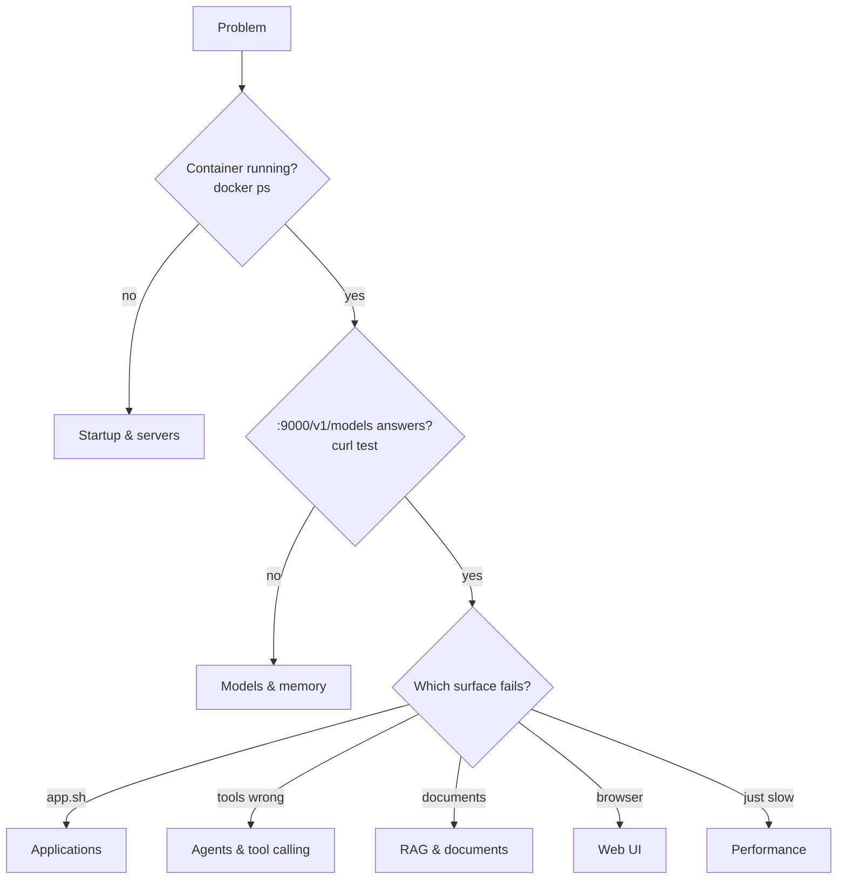

# WEDA LLM Suite — Troubleshooting Guide

## Contents

- [How to use this guide](#how-to-use-this-guide)
- [First 60 seconds: triage](#first-60-seconds-triage)
- [Error-message index](#error-message-index)
- [Container & Docker failures](#container--docker-failures)
- [Startup & servers](#startup--servers)
- [Models & memory](#models--memory)
- [Memory & RAM deep-dive](#memory--ram-deep-dive)
- [Applications (app.sh)](#applications-appsh)
- [Agents & tool calling](#agents--tool-calling)
- [RAG & documents](#rag--documents)
- [Web UI](#web-ui)
- [Performance](#performance)
- [Benchmarks & tests](#benchmarks--tests)
- [Configuration errors](#configuration-errors)
- [Model swapping during live use](#model-swapping-during-live-use)
- [Common user mistakes (edge cases)](#common-user-mistakes-edge-cases)
- [Reading the logs](#reading-the-logs)
- [Known limitations (with references)](#known-limitations-with-references)
- [Collecting a support report](#collecting-a-support-report)

## How to use this guide

1. Run the [triage commands](#first-60-seconds-triage) — they localise the
   problem to one layer in under a minute.
2. If you have an exact error message, jump straight to the
   [error-message index](#error-message-index).
3. Otherwise go to the section for the layer triage pointed at. Every fix is
   a runnable command.
4. Behaviour that looks wrong but is by design is listed under
   [Known limitations](#known-limitations-with-references) — each entry cites
   the upstream documentation that defines it.



## First 60 seconds: triage

Run these on the device, in order. Each one isolates a layer:

```bash
docker ps --format '{{.Names}}\t{{.Status}}'   # 1. which services are up
```
Expect `weda-llm-suite`, `weda-llm-suite-gateway`, `open-webui` (+ `-embed` if
started with `--embed`). Anything missing → [Startup & servers](#startup--servers).

```bash
curl -s http://127.0.0.1:9000/v1/models        # 2. generation server
```
JSON with a model id = serving. The id **is the active profile name** — apps
compare against it. Connection refused → [Models & memory](#models--memory)
(still loading, or crashed: `./build.sh --logs`).

```bash
curl -s http://127.0.0.1:9002/                 # 3. gateway
```
JSON listing the applications = gateway healthy. This is also the fastest way
to see every app, its tools, and a ready-made `curl` for each.

```bash
free -m | head -2                              # 4. memory reality
```
`available` below ~3000 MB explains most load failures on this 8 GB device.

```bash
./app.sh check                                 # 5. per-profile fit verdicts
```

## Error-message index

Exact strings the tooling prints, and where to go:

| Message contains | Go to |
|---|---|
| `llama-server not present` | [Startup & servers](#startup--servers) |
| `EntryNotFoundError` (gguf_file not in the repo) | [Models & memory](#models--memory) |
| `unknown model architecture` | [Models & memory](#models--memory) + [limitation L2](#known-limitations-with-references) |
| `could not flush page caches` | [Startup & servers](#startup--servers) + [limitation L5](#known-limitations-with-references) |
| `container 'weda-llm-suite' is not running` | [Applications](#applications-appsh) |
| `Application '...' not found` | [Applications](#applications-appsh) |
| `declares profile ... but the server is serving` | [Applications](#applications-appsh) |
| `unknown tool(s)` / `unknown sampling key(s)` | [Applications](#applications-appsh) |
| `kind 'agent' needs a backend: llamacpp profile` | [limitation L1](#known-limitations-with-references) |
| `returned the tool call as TEXT` | [Agents & tool calling](#agents--tool-calling) + [limitation L1](#known-limitations-with-references) |
| `echoed the tool schema as text` | [Agents & tool calling](#agents--tool-calling) — the served model is too small for native tool calling |
| `no telemetry recorded yet for this window` | [Agents & tool calling](#agents--tool-calling) — the recorder needs run-time to accumulate history |
| `collection ... is empty` | [RAG & documents](#rag--documents) |
| `docs directory ... does not exist` | [RAG & documents](#rag--documents) |
| `embedding server is not reachable` | [RAG & documents](#rag--documents) |
| `needs the embedding server and it is not running` | [RAG & documents](#rag--documents) |
| `the model server is not reachable -- a model swap or first-use download` | [Model swapping during live use](#model-swapping-during-live-use) |
| `input ... is too large to process. increase the physical batch size` | [RAG & documents](#rag--documents) |
| `FileNotFoundError: .../llm_config.yaml` (in-container) | [Container & Docker failures](#container--docker-failures) |
| `n_ctx must be` / `parallel must be` / `cache_type_k ... invalid` | [Configuration errors](#configuration-errors) |
| `chunk_overlap (...) must be smaller` | [Configuration errors](#configuration-errors) |
| `needs tool calls, which the Python backend` | [Applications](#applications-appsh) |
| `only attached images are supported` | [Web UI](#web-ui) |
| `reranker '...' is not in the model cache` | [RAG & documents](#rag--documents) |
| `is not in the model cache` (serve) | [Model swapping during live use](#model-swapping-during-live-use) |
| `huggingface-hub is not installed` / `pyyaml is not installed` | [Models & memory](#models--memory) |
| `DOES NOT FIT NOW` (from `app.sh check`) | [Models & memory](#models--memory) |
| `could not select device driver "" with capabilities: [[gpu]]` | [Container & Docker failures](#container--docker-failures) |
| `port is already allocated` / `address already in use` / `couldn't bind HTTP server socket` / `port N is already served by another process` | [Container & Docker failures](#container--docker-failures) |
| `Conflict. The container name ... is already in use` | [Container & Docker failures](#container--docker-failures) |
| `no space left on device` | [Container & Docker failures](#container--docker-failures) |
| `pull access denied` / `unauthorized` / `artifact ... not found` / `manifest unknown` | [Container & Docker failures](#container--docker-failures) |
| `Killed` in logs / server vanishes mid-request | [Memory & RAM deep-dive](#memory--ram-deep-dive) |
| `FAIL: zero completion tokens` | [Benchmarks & tests](#benchmarks--tests) |
| `FAIL: ... below gate` | [Benchmarks & tests](#benchmarks--tests) |
| `[ERROR] no served model at` (test_curl) | [Benchmarks & tests](#benchmarks--tests) |
| `missing required key(s) [...]` | [Configuration errors](#configuration-errors) |
| `expects profile ... but the server is serving` (HTTP 409 in UI/API) | [Model swapping during live use](#model-swapping-during-live-use) |
| `internal gateway error -- see ./build.sh --logs` (HTTP 500) | [Configuration errors](#configuration-errors) — the underlying cause is in `./build.sh --logs` |
| `$'\r': command not found` / `set: pipefail: invalid option name` | [Common user mistakes](#common-user-mistakes-edge-cases) |
| `yaml.scanner.ScannerError` / `found character '\t'` | [Common user mistakes](#common-user-mistakes-edge-cases) |

## Container & Docker failures

Failures before any WEDA process runs — `docker compose` or the daemon itself
rejects the start. Reference: [NVIDIA Container Toolkit troubleshooting](https://docs.nvidia.com/datacenter/cloud-native/container-toolkit/latest/troubleshooting.html).

| Symptom | Cause | Fix |
|---|---|---|
| `could not select device driver "" with capabilities: [[gpu]]` | NVIDIA container runtime not registered with Docker | configure per the toolkit guide, `sudo systemctl restart docker`; verify with `docker info \| grep -i nvidia` |
| `unknown runtime specified nvidia` | same as above — `runtime: nvidia` in compose has no backing runtime | same fix |
| `port N is already served by another process` (the launcher, before starting), `couldn't bind HTTP server socket ... port: 9000` (the serving log), `port is already allocated` / `address already in use` | another process owns 9000/9001/9002/3000 (often a previous manual run, another Open WebUI, a second compose project, or another OpenAI-compatible server); the launcher refuses to start while a port is held by something that is not this stack, so one serving stack per device | `sudo ss -ltnp \| grep -E '9000\|9001\|9002\|3000'` to find it; stop it, or change the port in `.env` |
| `Conflict. The container name "/weda-llm-suite" is already in use` | stale container from an interrupted run | `docker rm -f weda-llm-suite` (repeat for `-embed`, `-gateway`), then `./build.sh` |
| `pull access denied` / `unauthorized` on the image; `unknown: artifact ... not found` or `manifest unknown` (the tag does not exist), then `FATAL: unexpected error at build.sh line N (command: docker compose up -d)` | registry requires login, or the image tag in `.env` is wrong | check `WEDA_LLM_IMAGE` spelling and tag first; `docker login harbor.edgesync.cloud` when the message is `denied` or `unauthorized` |
| `no space left on device` | Docker storage full — model caches and old images accumulate | `docker system df` to see usage; remove unused images (`docker image prune`) after checking with your admin; models in `HF_CACHE` can be moved to NVMe |
| Container restart-loops (`docker ps` shows Restarting) | all services restart automatically (`unless-stopped`); a loop means the server dies right after start — bad image, missing runtime, or OOM at model load | `docker logs <name>` for the real error, match it in this guide; `./build.sh --stop` breaks the loop |
| After a reboot the UI is up but nothing answers | containers restart automatically but the model reload takes ~10 s (minutes if the cache was cleared) | `./build.sh --status`; wait for the `READY` banner |
| Compose warns variables are unset | running `docker compose` directly from another directory | run via `./build.sh`, or `docker compose` from the bundle directory where `.env` lives |
| `.env` edits appear to do nothing | compose only applies env at container (re)creation; a plain `./build.sh` does not touch a running embedding container at all | `./build.sh --stop && ./build.sh` (add `--embed` if you use RAG) — restart is not enough for env changes |
| All documents / accounts gone after a restart | `docker compose down -v` was used — `-v` deletes the `rag-store` and `open-webui-data` volumes | re-ingest and recreate the account; always stop with `./build.sh --stop`, never `down -v` |
| `exec format error` | image pulled for the wrong CPU architecture (x86 image on aarch64) | check `WEDA_LLM_IMAGE` — it must be the `-orin` tag; `docker image inspect  \| grep Architecture` |
| `FileNotFoundError: .../config/llm_config.yaml` inside a container although the file exists on the host | the bundle directory was replaced wholesale (git checkout, rsync --delete, unzip) while containers ran — a bind mount keeps pointing at the old, orphaned directory | `./build.sh --stop && ./build.sh` after any wholesale file replacement |

## Startup & servers

| Symptom | Cause | Fix |
|---|---|---|
| `nvidia runtime not visible to docker` warning | Docker daemon missing the NVIDIA runtime | install/configure per [NVIDIA Container Toolkit guide](https://docs.nvidia.com/datacenter/cloud-native/container-toolkit/latest/install-guide.html); restart Docker |
| First start waits at "waiting for generation server" | cold cache — the model (2–5 GB) is downloading | watch `./build.sh --logs`; pre-fetch with `scripts/download_models.py`; later starts are near-instant |
| `not ready after 900s` | download stalled or load failed | `./build.sh --logs`, then match the error in [Models & memory](#models--memory) |
| `FATAL: /usr/local/bin/llama-server not present` | image older than 1.0.0-orin | `docker compose pull`, restart. Interim: `backend: python` profiles serve chat only (see [L1](#known-limitations-with-references)) |
| Server exits immediately | insufficient free memory or bad profile value | `./build.sh --stop`, wait, retry; run `./app.sh check <profile>`; `free -m` |
| `could not flush page caches` warning | container not privileged (compose was edited) | restore `privileged: true`; see [L5](#known-limitations-with-references) for why the flush exists |
| Gateway up but `:9000` down | generation server still loading or crashed | gateway is independent by design; `./build.sh --logs` for the server |

## Models & memory

| Symptom | Cause | Fix |
|---|---|---|
| `download_models.py --status` says `cached` but `./build.sh` says `model not in the cache` | the downloader and the bundle resolved different caches (an explicit `HF_HOME` in your shell, or `HF_CACHE` changed after the download) | `download_models.py` prints the cache it uses on every run — it must equal `HF_CACHE` in `.env`; unset a conflicting `HF_HOME`, re-run the download |
| `[ERROR] huggingface-hub is not installed on the host` / `pyyaml is not installed` | `download_models.py` runs on the host and needs both | `pip install huggingface-hub pyyaml` (host, not container) |
| `[ERROR] N download(s) failed` | network drop, rate limiting, or a gated repo without a token | re-run (downloads resume); for gated repos set `HF_TOKEN` in `.env` |
| `EntryNotFoundError` / 404 during model resolve | `gguf_file` doesn't match a file in `hf_repo` | open the repo's Files page on Hugging Face and copy the exact filename into the profile |
| `exceeds the available context size` on the FIRST message of a chat | the client attached tool/function specs to the request; `--jinja` renders them into the prompt (Open WebUI does this by default) | the gateway strips client tool specs on chat/rag apps -- if this appears, the gateway is outdated or bypassed (direct :9000 calls carry client payloads verbatim) |
| `exceeds the available context size` | conversation history outgrew the window (`n_ctx`) | through the gateway this self-heals: the oldest turns are dropped and the request retried (log line `context overflow: dropping oldest turn`); if it still appears, the single current message is itself larger than the window -- shorten it, or raise `n_ctx` (`parallel: 1`, `cache_type_k/v: q8_0`). Direct :9000 clients get the raw rejection |
| `unknown model architecture` | model newer than the engine build ([L2](#known-limitations-with-references)); always the case for Qwen3.5/Gemma 4/Nemotron 3 on `backend: python` ([L3](#known-limitations-with-references)) | use `backend: llamacpp`; if it persists there, the image needs a newer release |
| Load fails with an allocation / out-of-memory error | model + KV cache exceed free memory | run `./app.sh check <profile>` for the numbers; `./build.sh --stop` first; copy the `gemma4-e4b-q4km` shape for big models (`parallel: 1`, `cache_type_k/v: q8_0`); reduce `n_ctx` |
| `MemAvailable` warning in the banner | previous server or another workload holds memory | `./build.sh --stop`, stop other GPU workloads, retry |
| `DOES NOT FIT NOW` from `app.sh check` | free memory below the profile's computed need | free memory as above, or pick a smaller profile — the verdict shows both numbers |
| Download error mentioning `HF_HUB_OFFLINE` | offline mode with an empty cache | `HF_HUB_OFFLINE=0` in `.env` for the first pull, then back to 1 ([HF env-var reference](https://huggingface.co/docs/huggingface_hub/package_reference/environment_variables)) |
| Download 401/403 | gated repository | shipped profiles are ungated; for your own gated models set `HF_TOKEN` in `.env` |

## Memory & RAM deep-dive

The 8 GB is **unified** — CPU, GPU and OS draw from one pool, so "GPU memory"
problems surface as ordinary RAM pressure. Reference:
[Jetson AI Lab RAM optimization tips](https://www.jetson-ai-lab.com/tips_ram-optimization.html).

**How to see the truth:**

```bash
free -m                          # 'available' is the number that matters
sudo tegrastats --interval 2000  # live RAM + GPU + temperatures (Ctrl-C to stop)
dmesg -T | grep -i -E 'oom|killed process' | tail -5   # did the kernel kill us?
```

| Symptom | Cause | Fix |
|---|---|---|
| Server log ends abruptly, container exited 137, or `dmesg` shows `Out of memory: Killed process ... (llama-server)` | the kernel OOM-killer — model + KV + other workloads exceeded physical RAM | pick a smaller profile or reduce `n_ctx`/`parallel` (`./app.sh check` shows the arithmetic); stop desktop/GUI sessions and other containers |
| `Killed` hits the **CPU-side services** (Open WebUI, gateway, ingest) while a ceiling model serves | only zram (compressed RAM) is available as swap, so CPU processes have nowhere to go under pressure | add an 8 GB NVMe swap file — commands and sizing in README → Memory guidance → Swap file; the GPU side is unaffected either way |
| OOM only **mid-conversation**, start was fine | KV cache grows with context; the fit check budgets the profile's full `n_ctx`, but other memory users grew after start | close other workloads; switch the profile to `cache_type_k/v: q8_0` (halves cache); reduce `n_ctx` |
| Memory still low right after `./build.sh --stop` | freeing large allocations takes seconds; page cache holds released file pages | wait ~10 s; the next `serve` flushes caches itself. Manual check: `free -m` again before concluding a leak |
| `MemAvailable` low with nothing running | GUI desktop, zram swap pressure, or another user's processes | on headless deployments disable the desktop; review with `top -o %MEM`. Swap/zram sizing guidance is in the RAM-optimization page above |
| RAG ingest of a large corpus slows to a crawl / OOMs | embedding large batches while the generation model is resident | ingest happens chunk-file-by-file; for very large corpora, stop the generation server first (`docker stop weda-llm-suite`), run `--embed` only, ingest, then `./build.sh -p <profile>` |
| Swap thrashing (device unresponsive, storage LED solid) | model marginally over RAM, spilling to swap | this is the "runs but unusable" zone — treat a swap-dependent profile as not fitting; use the next size down |

Rule of thumb the tooling enforces: weights + KV cache + ~1.2 GB runtime must
fit inside `MemAvailable` — `./app.sh check` prints exactly this equation per
profile.

## Applications (app.sh)

| Symptom | Cause | Fix |
|---|---|---|
| `container 'weda-llm-suite' is not running` | servers not started — `app.sh` never starts them | `./build.sh` (add `--embed` for RAG-class apps) |
| `Application 'X' not found` + list | no such block under `applications:` | `./app.sh` lists what exists; add a YAML block to create one |
| `declares profile 'A' but the server is serving 'B'` (CLI / direct API) | running model ≠ what the app expects; `python-parity` is pinned to the Python-backend profile by design | `./build.sh --stop && ./build.sh -p A`, **or** point the app's `profile:` at B. The Web UI never offers such apps: they are hidden from the dropdown until their profile is served |
| An app is missing from the Web UI dropdown but `./app.sh` lists it | it is pinned to a profile that is not being served (e.g. `python-parity` while the C++ profile serves) | `curl -s http://127.0.0.1:9002/ \| python3 -m json.tool` shows `available: false` and the serving profile; serve its profile to bring it back |
| `unknown tool(s) [...]` | tool name not in the code registry | use a listed tool; new tools are code (`scripts/agent_demo.py`), never config |
| `unknown sampling key(s) [...]` | typo/unsupported key under `sampling:` | valid keys are listed in the error |
| Warning about an unknown key | typo in an app block (e.g. `system_promt`) | fix the key — unknown keys are ignored, never silently applied |
| `FATAL: no generation server at ...` (CLI) | `app.sh` never starts servers | `./build.sh` first (`--embed` for RAG apps) |
| `needs tool calls, which the Python backend profile ... cannot emit` (409/CLI) | an agent app was addressed while the Python-backend profile serves; the Web UI hides such apps but the CLI and direct API can still ask | serve a C++-backend profile: `./build.sh --stop && ./build.sh` |
| `WARN: application 'X' is kind agent with no tools` | an agent block without a `tools:` list behaves as chat | add tools, or set `kind: chat` |
| `WARN: backend 'python' ignores [...]` at serve start | llama-server-only keys (`parallel`, `jinja`, `flash_attn`, `cache_type_*`) set on a `backend: python` profile | informational — remove the keys or ignore the warning |
| Calculator tool: `disallowed expression element` | the expression used something outside safe arithmetic | numbers and + - * / ** % // parentheses only |

## Agents & tool calling

| Symptom | Cause | Fix |
|---|---|---|
| `server returned the tool call as TEXT` | Python backend is serving ([L1](#known-limitations-with-references)) | `./build.sh --stop && ./build.sh` (any C++-backend profile) |
| Agent answers but never uses a tool | model's choice — the startup probe prints a note when this happens | ask something needing live data ("device temperature?"); model families differ in tool eagerness |
| Agent replies with `<tools> {"type": "function"...` schema text, or `echoed the tool schema as text` | the served model is too small to emit native tool calls (the 1.7B sanity profile does this) — it regurgitates the tool definitions instead of calling them | swap to a tool-capable profile (`./build.sh -p qwen3-4b-q4km`); agent apps are hidden from the model list while a `tool_calls: false` profile is served |
| `uses search_documents but the embedding server is not reachable` | agent app with document search; embed server down | `./build.sh --embed` |
| `(stopped: exceeded max tool rounds)` | model looping on tool calls | rephrase; if persistent on one model, use the default profile for agent work |
| Tool calls work in terminal but not via Web UI | gateway not being used (UI pointed elsewhere) | UI must use `:9002` (`OPENAI_API_BASE_URL` in `docker-compose.yml`) |
| History/alert/anomaly tools say "no telemetry recorded yet" | the recorder runs in the gateway and accumulates over time — a freshly started stack has little history; anomaly checks need a few hours of baseline | wait; the recorder samples every 30 s by default (`monitoring.interval_sec` in `llm_config.yaml`) |
| `list_containers` / `container_stats` say "docker socket not mounted" | the read-only docker introspection tools need the socket (older compose) | recreate with the current `docker-compose.yml` (mounts `/var/run/docker.sock`); `./build.sh --stop && ./build.sh` |
| `explain_recent_errors` says "log directory not mounted" | the read-only host log mount is absent (older compose) | recreate with the current `docker-compose.yml` (`./build.sh --stop && ./build.sh`) |
| Operator notes recall by keyword, not meaning | the embedding server is not running — notes are still saved and keyword-searchable | `./build.sh --embed` for semantic recall |
| Web UI shows "Connection lost. Reconnecting..." constantly; UI logs say `is not an accepted origin` | `CORS_ALLOW_ORIGIN` does not include the origin your browser uses — the UI's websocket validates it on every connection, even same-origin | set `CORS_ALLOW_ORIGIN` in `.env` to the origin shown in the log (e.g. `http://<device-ip>:3000`), or unset it to accept the `*` default; recreate the stack |
| UI logs warn `CORS_ALLOW_ORIGIN IS SET TO '*'` | the shipped default favors working out of the box; `*` lets other sites in a LAN browser call the UI API cross-origin (without credentials) | harden by setting `CORS_ALLOW_ORIGIN` in `.env` to your device's real origin(s), `;`-separated |
| `request body N bytes exceeds the 32 MiB limit` (HTTP 413) | one request carried more than 32 MiB — usually a very large base64 image attachment | send smaller/downscaled images; split oversized documents through `ingest` instead of pasting them into the chat |
| `nvpmodel is not runnable inside this container` | the nvpmodel bind-mounts are missing — compose predates them, or the host keeps the binary elsewhere | re-pull the bundle's `docker-compose.yml` and recreate (`./build.sh --stop && ./build.sh`); confirm the host path with `which nvpmodel` |
| `the switch did NOT take effect` from `set_power_mode` | the mode write did not land — most often `/var/lib/nvpmodel` is not shared with the host, so container and host disagree about the active mode | recreate with the current compose (it mounts `/var/lib/nvpmodel`); verify on the host with `sudo nvpmodel -q` |
| `'N' is not a known mode id` from `set_power_mode` | the requested id is not defined in `/etc/nvpmodel.conf` | ask for the modes first ("what power modes are available?") and use an id from that list |
| `could not flush page caches` from `free_memory` | container not privileged | restore `privileged: true` in compose ([L5](#known-limitations-with-references)) |
| GPU usage reads `unavailable on this kernel` | no readable GPU load node under `/sys/class/devfreq` (path varies by JetPack) | expected on some kernels; frequency, memory and CPU figures are unaffected |

## RAG & documents

| Symptom | Cause | Fix |
|---|---|---|
| `collection '...' is empty` | nothing ingested | `./app.sh <rag-app> ingest` |
| `reranker '...' is not in the model cache` | an app has `rerank: true` and the cross-encoder is not resolvable offline: never downloaded, or cached without its `refs/main` pointer (a cache written by an older downloader) | `python3 scripts/download_models.py --rerank` (no container restart needed); it writes the pointer for the pinned revision, and the app loads the reranker at that revision |
| `docs-qa-verified` takes 15–40 s per question | by design: grade, optional rewrite+retry, answer, verify = 3–5 model calls at ~20 tok/s | use `docs-qa` for conversational speed; keep `verified` for answers that will be acted on |
| Verified answer ends with `(verification: a statement above could not be confirmed ...)` | the checker found a claim the sources do not support, and a strict re-answer still carried it | treat the flagged statement as unconfirmed; the cited snippets are the ground truth |
| Answers improved after re-ingest but an old document still ranks oddly | the BM25 index is built from the collection and refreshed when its size changes | re-run `ingest`; the index rebuilds automatically |
| `docs directory ... does not exist` | app's `docs_dir` missing under the `DOCS_DIR` mount | set `DOCS_DIR` in `.env`, `./build.sh --stop && ./build.sh --embed`, retry |
| `no supported documents under ...` | nothing in the folder has a supported extension (text, HTML, PDF, DOCX/PPTX/XLSX) | `ingest` lists what it skipped; legacy `.doc`/`.xls`/`.ppt` → save as `.docx`/`.xlsx`/`.pptx`; images need OCR first |
| `skip <file>: no extractable text` | an empty document, or a scan/image whose OCR found nothing (handwriting, very low resolution, non-English) | re-scan at ≥ 200 dpi; OCR is English-only as shipped |
| `skip <file>: OCR (tesseract) not available in this image` | image older than the OCR-enabled release | pull the current `weda-llm-base`; until then export scans to text first |
| Ingest of a scanned PDF takes many minutes | OCR runs on the CPU, seconds per page | expected for large scans; run it once, it persists |
| `skip <file>: cannot parse` | corrupt or password-protected file | re-export the file; remove passwords |
| Answers ignore edited documents | the collection still holds the previous version | re-run ingest — changed files are detected by content digest and re-indexed; unchanged files are skipped. Full reset: `docker volume rm weda-llm-suite-rag-store` (removes ALL collections) |
| Answers cite deleted documents | ingest has not run since the file was removed | re-run ingest — files no longer in the corpus are removed from the index automatically (a `removed from index` line per file) |
| `database is locked` during ingest | CLI ingest and a UI query hit the vector store at the same moment (sqlite locking is best-effort across processes) | retry the ingest; avoid querying RAG apps while an ingest runs |
| `embedding server not reachable` | started without `--embed` | `./build.sh --embed` |
| UI: `needs the embedding server and it is not running` (503) | a RAG/search app was selected in the Web UI without the embedding server | `./build.sh --embed`; first use also needs `./app.sh <app> ingest` |
| `input (N tokens) is too large to process. increase the physical batch size` | a single embedding input exceeds the embedder's 8k window (huge file pasted into one message) | shorten the input; for corpora, ingest via `docs-qa` — chunking keeps every piece small |
| `Permission denied ... falling back to console logging` from `download_models.py` | the containers download models as root, so parts of the shared cache are root-owned; the host-side tool cannot write an auxiliary log there | harmless — downloads succeed; to silence it: `sudo chown -R "$USER:$USER" <HF_CACHE>` (see README → Permissions) |

## Web UI

| Symptom | Cause | Fix |
|---|---|---|
| Chat errors in the UI | gateway (`:9002`) or server (`:9000`) not answering | run the [triage](#first-60-seconds-triage) curls; `./build.sh --logs` |
| `image input is not supported ... provide the mmproj` (500) | an image reached the text model directly (gateway bypassed, or an older gateway) | through the gateway images are OCR'd to text; update the bundle |
| `this deployment serves a text model: images cannot be viewed, and OCR is not available` (400) | image older than the OCR-enabled build | rebuild/re-pull `weda-llm-base`; until then paste the text |
| `only attached images are supported (not remote image URLs)` (400) | a message referenced an image by URL; the gateway only OCRs attached (base64) images | attach the file instead of linking it |
| `Content-Length required` (411) | a hand-written API client sent no body length | send a normal JSON body; every standard OpenAI client does |
| Gateway log: `WARN: upstream closed the stream early` | the model server ended a stream without the terminator; the gateway delivered the partial text and closed cleanly | the reply shown is what was generated; check the model server log for the cause |
| Any script: `FATAL: unexpected error at line N (command: ...)` | a failure outside every known path — the trap names the exact line and command | report it with that line; nothing exits silently by design |
| Image answered with `(no readable text)` | the picture carries no printed text (scene photo, diagram) or is too small | only text is extracted; upscale/crop screenshots to the text region |
| App missing from the model dropdown | config edited after gateway start, or invalid block | check `./app.sh` lists it; `./build.sh --stop && ./build.sh`; refresh browser |
| `docs-qa` in the UI says the collection is empty | ingest happens via CLI, not the UI | `./build.sh --embed`, then `./app.sh docs-qa ingest` |
| Web UI answers about a file I attached earlier, not the one I just asked about | Open WebUI keeps every attachment of a chat in its per-chat retrieval | start a new chat per document, or use `docs-qa` over `DOCS_DIR` where each app has its own collection |
| "Who is the author / what is the title" gets "not mentioned" although it is on page 1 | similarity retrieval rarely selects a title page for a metadata question | in `docs-qa` the ingest header (`[document] file \| title \| author \| pages`) answers this — re-run `ingest` after updating; Open WebUI's own attachment retrieval has no equivalent |
| UI unreachable from another machine | firewall on device port 3000 | open port 3000; the inference API itself stays loopback-only by default |
| First visit asks to create an account | Open WebUI authentication is on by default | create the admin account; behaviour is Open WebUI's, see [its docs](https://docs.openwebui.com/) |
| A second person signs up but cannot use the UI ("pending") | new sign-ups wait for admin approval by design — the port is reachable LAN-wide, so accounts are not activated automatically | as admin: Admin Panel → Users → set the account active |
| Stale model list after profile switch | UI caches `/v1/models` | refresh the page once the server is ready |

## Performance

| Symptom | Cause | Fix |
|---|---|---|
| Well below the profile's tok/s class | power mode / clocks | `sudo jetson_clocks`, select the MAXN/25 W mode — see [NVIDIA power & performance docs (r36.x / JP6)](https://docs.nvidia.com/jetson/archives/r36.4/DeveloperGuide/SD/PlatformPowerAndPerformance.html) |
| Slow and hot | thermal throttling | `./app.sh device-assistant "device temperature?"`; cooling, reduce load |
| Slow only in long conversations | context filling toward `n_ctx` | expected; raise `n_ctx` only with headroom (`./app.sh check` recomputes) |
| First request slow | model warm-up | send one `./app.sh curl` warm-up query; timings after it are representative |
| Worse after enabling `q8_0` KV cache on a small model | quantised KV trades compute for memory ([L4](#known-limitations-with-references)) | keep `f16` when it fits; `q8_0` is for fitting, not speed |

## Benchmarks & tests

Covers `./wise-bench` and `./app.sh curl`.

| Symptom | Cause | Fix |
|---|---|---|
| `./wise-bench` shows FAIL rows | the named capability genuinely does not work in this container — each row's detail states what was executed and what came back | fix the failing capability (the usual suspects: wrong image for the device on the CUDA row, stack down for `[live]` rows — those skip, never fail); `test_logs/wise-bench.json` has the full record |
| `./wise-bench` shows many `skip` rows | skips are stated conditions, not failures: stack not running (live checks), reranker not downloaded, python backend absent | start the stack / download the component the skip names, or accept the skip — exit code ignores skips |
| bench: `FATAL: no server at ...` | bench never starts servers | `./build.sh` first |
| bench: `request FAIL: timed out` | per-request timeout too tight for the model class (large model, cold caches) | raise `timeouts.per_request_sec` in the profile; re-run after one warm-up request |
| bench: `FAIL: zero completion tokens` | server answers HTTP but generates nothing — wrong/corrupt model load or a template problem | `./build.sh --logs`; re-download the GGUF if the file was interrupted (delete it from `HF_CACHE`, re-fetch) |
| bench: `FAIL: N request(s) failed` mixed with successes | memory pressure under concurrency | see [Memory & RAM deep-dive](#memory--ram-deep-dive); reduce the profile's `stress.concurrency` |
| bench: `FAIL: ... below gate` | measured tok/s under the profile's `throughput_min_tok_per_sec` | first check clocks/thermals ([Performance](#performance)); if the environment is correct, the gate may predate a config change — re-baseline and update the gate |
| bench PASS says `[MEASURED — no gate set]` | not an error — the profile has no gate yet | record a baseline, set the gate ~20 % below it |
| `test_curl`: `[ERROR] no served model at` | generation server down or still loading | `./build.sh --status`; wait for the `READY` banner in `./build.sh --logs` |
| wise-bench (image-level) reports FAIL | a platform check failed **or the harness itself is at fault** | before blaming the image, reproduce the failing operation manually (e.g. one `curl` completion); report both results together |
| wise-bench `exec:*` check FAIL (`exec:torch-cuda-matmul`, `exec:tensorrt-engine-build`, `exec:ocr-tesseract`, …) | each executes a real capability with a checked result — a FAIL means that capability is genuinely broken in the image, not a cosmetic probe | the check name states what to reproduce manually; `exec:ocr-tesseract` failing on an image built before OCR was added means re-pull/rebuild |
| wise-bench `triton-jit-kernel` FAIL | triton JIT needs a working ptxas and a C compiler at kernel launch | reproduce with any triton kernel in-container; usually an image-build issue, report it |
| wise-bench reports SKIP | the check's precondition is absent on this profile (e.g. vLLM checks on a llama.cpp device) | expected — SKIP text names the precondition; not a failure |
| Bench numbers vary run-to-run | thermals, power mode, background load | fix clocks (`sudo jetson_clocks`), close other workloads, compare medians of 3 runs |

Test artifacts land in `test_logs/` (mounted from the host, survives container
recreation).

## Configuration errors

`config/llm_config.yaml` is validated on every use — apps and the gateway read
it per request, so a bad edit surfaces immediately and everywhere. Errors name
the block and the problem; fix the file and simply retry (no restart needed
for apps; the serving profile itself needs a server restart).

| Symptom | Cause | Fix |
|---|---|---|
| `missing required key(s) ['backend', 'gguf_file', 'hf_repo']` | a profile block lacks its mandatory keys | add the listed keys — compare with a shipped profile |
| `missing required key(s) ['kind']` | an application block lacks its mandatory key | every app needs `kind`; `profile` is optional and falls back to `default_profile` |
| `Profile '...' not found. Available: ...` | app points at a deleted/renamed profile, or `default_profile` is stale | pick from the printed list |
| `kind '...' invalid (valid: chat, agent, rag)` | typo in `kind` | use one of the three |
| `unknown tool(s)` / `unknown sampling key(s)` | typo'd names in `tools:`/`sampling:` | valid options are printed in the error |
| `profile 'X': n_ctx must be ...` / `parallel must be >= 1` / `cache_type_k '...' invalid` / `backend '...' invalid` | a profile value is out of range, mistyped, or quoted as a string | the message names the key and the valid values — the fit check and the server both rely on these being right |
| `application 'X': chunk_overlap (...) must be smaller than chunk_chars` | overlap ≥ chunk size would chunk one character at a time | lower `chunk_overlap` or raise `chunk_chars` |
| `No 'applications' section in llm_config.yaml` / `No 'embedding' section` | the section was deleted or de-indented during an edit | restore it — compare with the shipped file; the embedding block is required by RAG apps |
| `No profile_name provided and no default_profile set` | `default_profile:` was removed | set it to any profile name |
| `yaml.scanner.ScannerError` / `ParserError` in any tool | broken YAML syntax (bad indent, tabs, unclosed quote) | the error names the line; YAML uses spaces only |
| Web UI: every app suddenly errors with `gateway error: ...` (500) | the gateway reads config per request — a syntax-broken file takes down ALL apps at once | fix the YAML; requests recover immediately, no restart |
| Two blocks with the same name; one seems ignored | duplicate YAML keys — the last silently wins | keep names unique; there is no duplicate warning (YAML semantics) |
| Edits to an app apply in `app.sh` but the serving model didn't change | apps re-read config per run; the **server** reads its profile only at start | `./build.sh --stop && ./build.sh -p <profile>` for serving-side keys (`n_ctx`, model, cache types) |

## Model swapping during live use

Two supported ways to change the model:

1. **Hot swap (no container restart)** — edit `default_profile:` in
   `config/llm_config.yaml` on the host. The supervisor inside the container
   detects the change within ~2 s, stops the server (30 s grace), flushes
   caches and starts the new model. Apps without a `profile:` key follow
   automatically.
2. **Full restart** — `./build.sh --stop && ./build.sh -p <new>`; `-p` pins
   the profile for the container's lifetime (config edits then swap the
   profile's body, not its name).

What each surface does during either swap:

| Surface | During the swap | After the swap |
|---|---|---|
| In-flight requests (UI, `app.sh`, API) | fail with connection reset / timeout when the server stops — expected, nothing hangs | retry once the server is ready |
| Web UI / gateway apps | — | requests are **checked against the served model**: an app expecting the old profile gets HTTP 409 naming both profiles and both remedies — never a silent answer from the wrong model (the check caches 5 s, so the very first request after a swap can still be refused up to 5 s late) |
| Terminal apps (`app.sh`) | — | same guard at startup; running REPLs hit it on their next request |
| Embedding server / RAG store | unaffected — separate process, persistent volume | ingest done before the swap remains valid |
| Open WebUI chat history | kept (client-side) | continuing an old conversation sends the history to the app you select now — fine after the 409 is resolved |

| Symptom | Cause | Fix |
|---|---|---|
| `./build.sh` exits with `model not in the cache` | the profile's GGUF (or the embedding model with `--embed`) has not been downloaded; `build.sh` never downloads | `python3 scripts/download_models.py`, then `./build.sh` again |
| Swap to a new model idles with `HOT SWAP FAILED: ... not in the model cache` | swaps never download either | `python3 scripts/download_models.py` for that profile, then save or `touch config/llm_config.yaml` |
| UI shows `model '<name>' is loading (swap or startup in progress)` (503) | the swap/startup is underway — the gateway names the incoming model | wait for the `READY` banner, then retry |
| UI shows `the model server is idle after a failed swap: <reason>` (503) | the last swap failed and the gateway carries the exact reason (fit refusal with numbers, model not in cache, bad flag) | fix `config/llm_config.yaml` per the stated reason and save it — the supervisor relaunches on save |
| UI shows `the model server is not reachable` (503) | server down before it ever wrote a status (first boot), or the status file is unavailable | `./build.sh --status` tells the state; retry after the `READY` banner |
| UI shows `the model server did not answer within 300 s` (504) | request queued behind a busy slot (`parallel: 1` serves one conversation at a time) or a very long generation | wait and retry; for concurrent users use a `parallel: 2` shape (`n_ctx: 4096`) |
| UI shows `expects profile 'A' but the server is serving 'B'` (409) | app's declared profile ≠ live model — after a swap, or after syncing a config whose `default_profile` differs from what is running | `./build.sh --status` names both sides and prints the two reconciliation commands: serve A (`./build.sh --stop && ./build.sh`) or set `default_profile:`/the app's `profile:` to B |
| Same 409 up to ~5 s **after** fixing the server | the guard's short cache | retry; it clears within 5 s |
| Swap "didn't take" — old model still answering | container was started with `-p` (pins the name), or the YAML edit didn't change `default_profile` | serving log shows `hot-swapping the model` when the watch fires; for a pinned container use the full-restart path |
| Hot swap into a broken/missing profile, or the new server exits right after launch (bad `extra_serve_args`, unsupported model, `n_ctx` too large) | new config invalid at relaunch, or rejected by llama-server | serving log prints a boxed `HOT SWAP FAILED: <reason>` and the container idles; `./build.sh --status` reports `IDLE after a failed hot swap` with the reason. Fix the config and save (or `touch config/llm_config.yaml`) to relaunch |
| After a failed swap the model never comes back, even though the cause is fixed (e.g. the model finished downloading) | the supervisor retries only on a config CHANGE, not on a timer | `touch config/llm_config.yaml` (or re-save it) — the watch fires and relaunches; `READY` banner confirms |
| No obvious signal that a swap finished | — | the serving log prints a boxed `READY -- serving '<model>'` banner after every load; `./build.sh --status` shows the served model any time |
| 409s from pinned apps after a hot swap | apps with an explicit `profile:` key don't follow the default | remove the pin to make them follow, or serve their profile |
| Swap (or start) refuses with `does not fit: N GiB needed ... vs M GiB available (after reclaiming from other containers)` | the fit gate: computed weights + KV + runtime exceed live free memory even after reclaiming the other containers' idle memory into swap — this replaces attempting the load and OOMing | free memory (stop other workloads/desktop) or shrink the shape (`n_ctx`, `parallel`, smaller model); the server idles — fix and re-save the config. Hybrid archs get a 0.5 GiB grace margin since their KV estimate is an upper bound |
| `headroom reclaim: +0 MiB freed` before a refusal | the other containers' memory is anonymous (heap) and there is no swap to reclaim it into — reclaim needs an enabled swap device | enable swap (see the swap-file section in the README); with swap present the reclaim frees the Web UI's idle memory automatically |
| `headroom reclaim: no sibling cgroups visible` | the container cannot see the other containers' cgroups — `cgroup: host` missing from `docker-compose.yml` (older copy) | update to the current compose file and recreate (`./build.sh --stop && ./build.sh`) |

## Common user mistakes (edge cases)

Each of these has bitten real users; all are cheap to check.

| Symptom | Cause | Fix |
|---|---|---|
| `$'\r': command not found` or `set: pipefail: invalid option name` running `./build.sh` | scripts edited on Windows — CRLF line endings (which line fails first depends on where the first CRLF is) | `sed -i 's/\r$//' build.sh app.sh entrypoint.sh` (or configure the editor for LF) |
| `yaml.scanner.ScannerError` mentioning `'\t'` | a TAB character in `llm_config.yaml` — YAML forbids tabs for indentation | replace tabs with spaces at the reported line |
| `bash: ./build.sh: Permission denied` (same for `app.sh`) | execute bits lost when the bundle was copied or extracted | `chmod +x build.sh app.sh entrypoint.sh wise-bench scripts/test_curl.sh` — and `chmod +x` on the bundle directory itself if `cd` into it fails (see README → Setup) |
| `permission denied` on `./build.sh` talking to Docker | user not in the `docker` group | `sudo usermod -aG docker $USER`, then log out/in — avoid running the whole stack as root |
| App edits ignored in the Web UI, but fine in `app.sh` | the gateway reads config per request, but the **browser page** caches the model list | refresh the page; hard-refresh if the dropdown is stale |
| Profile edits (n_ctx, model) ignored | the **server** reads its profile at start only | `./build.sh --stop && ./build.sh -p <profile>` |
| Can't delete files in `HF_CACHE` from the host | files were written by the container as root | `sudo chown -R $USER:$USER "$HF_CACHE"` — or manage the cache via `download_models.py` on the host so ownership stays yours |
| `docs_dir` set to an absolute host path | `docs_dir` is **relative to the DOCS_DIR mount**, host paths don't exist in-container | set `DOCS_DIR=.../corpus` in `.env` and `docs_dir: subfolder` (or `.`) in the app |
| Two terminals ran `./build.sh -p` with different profiles | last writer wins; apps then hit the profile-mismatch guard | one serving stack per device; check what's live with triage step 2 |
| `HF_TOKEN` committed into `.env` backups | `.env` holds the token in plain text | keep `.env` out of any VCS; the support-report command below strips it |
| Bundle copied without `docs_sample/` or `.env` | partial copy of the directory | copy the whole bundle directory; `ls` should match the README layout table |

## Reading the logs

```bash
./build.sh --logs                    # all services, follow
docker logs weda-llm-suite-embed      # embedding server only
docker logs weda-llm-suite-gateway    # gateway only
```

| Marker in the serving log | Meaning |
|---|---|
| `model loaded` → `listening on` | ready |
| `n_slots = N` | parallel capacity (profile's `parallel`) |
| `print_timing` lines | per-request tokens/sec |
| `page caches flushed` | pre-load memory cleanup ran |
| `[gateway] POST /v1/chat/completions` | a UI/API request reached an application |

## Known limitations (with references)

| # | Limitation | Upstream basis |
|---|---|---|
| L1 | **The Python backend cannot do native tool calling.** Its official docs support function calling only through dedicated handler formats ("you'll need to also specify either `functionary-v1` or `functionary-v2` chat_format"), which replace the model's own template — there is no `--jinja` equivalent. Agent apps therefore require the C++ backend, whose server documents OpenAI-style function calling under the `--jinja` flag ("Tool call support") | [llama-cpp-python server docs](https://llama-cpp-python.readthedocs.io/en/latest/server/) · [llama-server README](https://github.com/ggml-org/llama.cpp/tree/master/tools/server) |
| L2 | **A GGUF loads only if its architecture is in the engine build.** Newer model families fail with `unknown model architecture` on older engines; the fix is an engine update, never a config change | [llama.cpp](https://github.com/ggml-org/llama.cpp) (architecture support is added per-release; see its release notes) |
| L3 | **2026 families (Qwen3.5, Gemma 4, Nemotron 3) are C++-backend-only in this image** — the Python backend embeds an earlier engine that predates those architectures. Consequence of L2, verified against both engines in this image | same as L2 |
| L4 | **Quantised KV cache (`q8_0`) is a memory lever, not a speed lever**, and KV cache types are tied to flash attention. Both are official `llama-server` options (`--cache-type-k/v`, `--flash-attn`); quantising the cache halves its memory at a small per-token conversion cost | [llama-server README](https://github.com/ggml-org/llama.cpp/tree/master/tools/server) |
| L5 | **The pre-load page-cache flush needs a privileged container.** `drop_caches` is a root-only kernel control (`/proc/sys/vm/drop_caches`); on 8 GB unified memory, cached file pages from a previous model can otherwise starve the next load | [Linux kernel sysctl/vm documentation](https://docs.kernel.org/admin-guide/sysctl/vm.html#drop-caches) |
| L6 | **vLLM is not part of this device's stack.** For 8 GB Jetson SKUs, llama.cpp-class serving is the appropriate path; vLLM targets larger-memory devices (it is the WISE-Edge serving path on Jetson Thor) | [Jetson AI Lab models catalog](https://www.jetson-ai-lab.com/models/) (per-device engine listings) |
| L7 | **One resident generation model.** 4B Q4_K_M weights ≈ 2.3–2.7 GB plus KV cache plus OS on 8 GB total; concurrent models would exceed the envelope. Model sizing follows Advantech's published Jetson benchmarks | [Advantech llama.cpp on Jetson performance notes](https://github.com/Advantech-Containers/LLM-Llama.cpp-on-NVIDIA-Jetson/blob/main/llm-models-performance-notes-readme.md) |
| L8 | **Agent answers arrive as one block in the Web UI** — tool rounds must complete before the final text exists, so there is nothing to stream until the loop ends. Chat and RAG apps stream normally | inherent to tool-execution flows; gateway design |

## Collecting a support report

Attach the output of these when reporting an issue:

```bash
./build.sh --logs 2>&1 | tail -100
docker ps --format '{{.Names}}\t{{.Status}}\t{{.Image}}'
free -m
cat /etc/nv_tegra_release
./app.sh check 2>&1
grep -v HF_TOKEN .env
```

Plus: which command failed, its full output, and the application/profile names
involved. The config file (`config/llm_config.yaml`) is safe to attach — it
contains no secrets.
